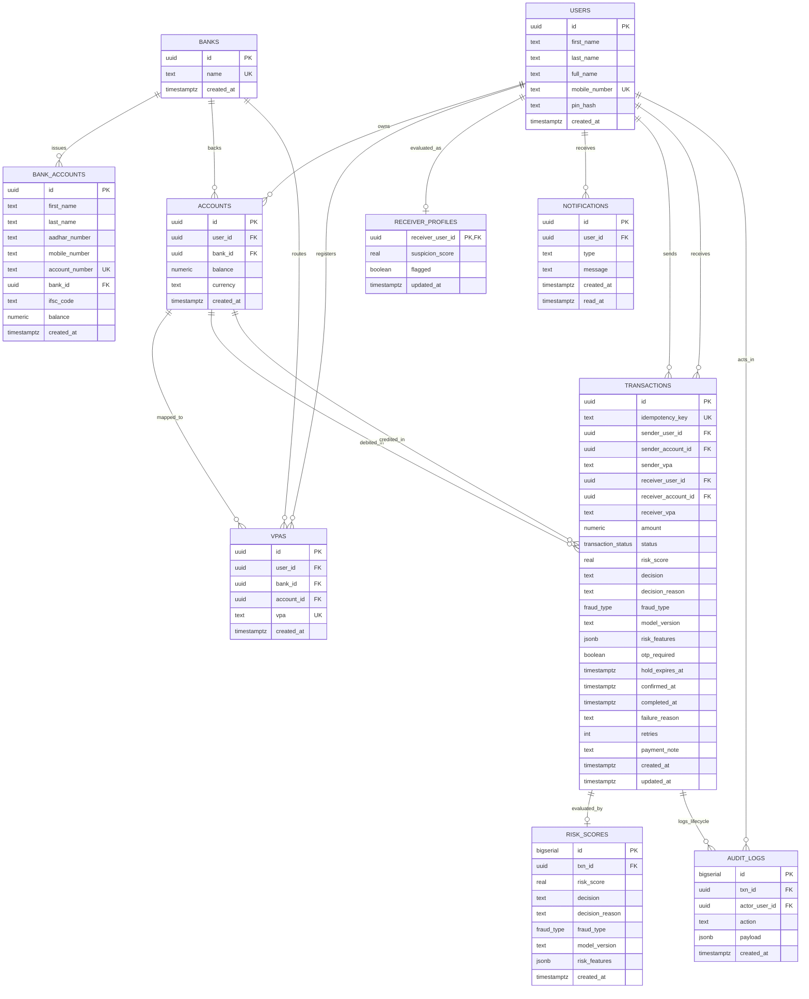

# ApexPay - Database Technical Documentation & Schema Specification

This document provides a comprehensive technical reference for the relational database schema of **ApexPay – Secure Payment Gateway**. The system is built on **PostgreSQL** (compatible with version 14+, tested with Supabase PostgreSQL) and enforces strict relational integrity, check constraints, immutable triggers, and optimized indexes.

---

## 1. Database Architecture & Engine Configuration

- **Database Engine:** PostgreSQL (Supabase Managed Cloud / Standard PostgreSQL)
- **Primary Driver:** `pg` (Node-Postgres v8.20.0) with client connection pooling (`Pool`, max 10 connections)
- **Extensions:** `pgcrypto` enabled for cryptographically secure UUID v4 generation (`gen_random_uuid()`)
- **Immutability Mechanisms:** PL/pgSQL row-level triggers preventing `UPDATE` and `DELETE` on financial audit logs and risk assessments.
- **Data Integrity:** Negative balances and non-positive transfer amounts are strictly prevented via database-level `CHECK` constraints.

---

## 2. Custom Enumerated Types (`ENUM`)

### 2.1 `transaction_status`
Represents the discrete states of a payment transaction across its lifecycle:
```sql
create type transaction_status as enum (
  'REQUESTED',   -- Transaction created, pre-settlement evaluation underway
  'HOLD',        -- Suspended for Step-Up Authentication (MFA / OTP verification)
  'APPROVED',    -- Validated and ready for two-phase ledger settlement
  'COMPLETED',   -- Successfully settled (sender debited, receiver credited)
  'FAILED',      -- Rejected by risk engine, canceled by user, or expired
  'RECOVERED'    -- Completed after a crash/network recovery sweep
);
```

### 2.2 `fraud_type`
Categorizes the detected threat vector in alignment with banking fraud taxonomy:
```sql
create type fraud_type as enum (
  'PHISHING',               -- Social engineering, credential harvesting, extreme deviation
  'QR_SCAM',                -- Malicious static/dynamic QR code diversion
  'ACCOUNT_TAKEOVER',       -- Unrecognized hardware device jump + distant geolocation
  'MULE_ACCOUNT',           -- Funneling funds into rapid aggregation accounts
  'UNKNOWN'                 -- Unclassified statistical risk
);
```
*(Note: Codebase also supports application-level tag `FIRST_TXN_HIGH_AMOUNT` handled through string serialization).*

---

## 3. Database Table Reference

### 3.1 `banks`
Maintains the registry of supported banking institutions within the payment ecosystem.

| Column | Data Type | Constraints | Description |
|---|---|---|---|
| `id` | `UUID` | `PRIMARY KEY`, `DEFAULT gen_random_uuid()` | Unique identifier for the banking institution. |
| `name` | `TEXT` | `NOT NULL`, `UNIQUE` | Name of the bank (e.g., 'Apex Bank', 'Neo Bank'). |
| `created_at` | `TIMESTAMPTZ` | `NOT NULL`, `DEFAULT now()` | Timestamp of record creation. |

---

### 3.2 `bank_accounts` (Simulated Core Banking Registry)
Acts as the simulated "Central Banking Registry" (CBS/NPCI Core Database) against which user mobile numbers and bank records are verified before allowing ApexPay onboarding.

| Column | Data Type | Constraints | Description |
|---|---|---|---|
| `id` | `UUID` | `PRIMARY KEY`, `DEFAULT gen_random_uuid()` | Unique account identifier in the core bank. |
| `first_name` | `TEXT` | `NULLABLE` | Account holder's legal first name. |
| `last_name` | `TEXT` | `NULLABLE` | Account holder's legal last name. |
| `aadhar_number`| `TEXT` | `NULLABLE` | 12-digit Indian national identity number. |
| `mobile_number`| `TEXT` | `NOT NULL` | Registered 10-digit mobile number linked to the bank account. |
| `account_number`| `TEXT` | `NOT NULL`, `UNIQUE` | Unique core bank account number (e.g., `ACT-111111`). |
| `bank_id` | `UUID` | `NOT NULL`, `REFERENCES banks(id)` | Foreign key linking to the bank. |
| `ifsc_code` | `TEXT` | `NULLABLE` | Indian Financial System Code (IFSC) for routing. |
| `balance` | `NUMERIC(14,2)`| `NOT NULL`, `CHECK (balance >= 0)` | Current balance in the core bank account. |
| `created_at` | `TIMESTAMPTZ` | `NOT NULL`, `DEFAULT now()` | Timestamp of account registration. |

---

### 3.3 `users`
Stores permanent identity profiles and credentials of registered ApexPay application users.

| Column | Data Type | Constraints | Description |
|---|---|---|---|
| `id` | `UUID` | `PRIMARY KEY`, `DEFAULT gen_random_uuid()` | Unique identifier for the user. |
| `first_name` | `TEXT` | `NOT NULL` | User's verified first name. |
| `last_name` | `TEXT` | `NOT NULL` | User's verified last name. |
| `full_name` | `TEXT` | `NULLABLE` | Full composite name (`first_name + ' ' + last_name`). |
| `mobile_number`| `TEXT` | `NOT NULL`, `UNIQUE` | User's unique 10-digit primary mobile login identity. |
| `pin_hash` | `TEXT` | `NULLABLE` | Bcrypt password hash (10 salt rounds) of user's 4-to-6 digit PIN. |
| `created_at` | `TIMESTAMPTZ` | `NOT NULL`, `DEFAULT now()` | Account creation timestamp. |

---

### 3.4 `accounts` (Internal ApexPay Wallet / Bank Accounts)
Represents the user's active, linked spending account within the ApexPay payment network.

| Column | Data Type | Constraints | Description |
|---|---|---|---|
| `id` | `UUID` | `PRIMARY KEY`, `DEFAULT gen_random_uuid()` | Unique identifier for the linked account. |
| `user_id` | `UUID` | `NOT NULL`, `REFERENCES users(id)` | Foreign key linking to account owner. |
| `bank_id` | `UUID` | `NOT NULL`, `REFERENCES banks(id)` | Foreign key linking to issuing bank. |
| `balance` | `NUMERIC(14,2)`| `NOT NULL`, `CHECK (balance >= 0)` | Available settlement balance. Protected against negative overdrafts. |
| `currency` | `TEXT` | `NOT NULL`, `DEFAULT 'INR'` | Currency code (default: Indian Rupee). |
| `created_at` | `TIMESTAMPTZ` | `NOT NULL`, `DEFAULT now()` | Link timestamp. |

- **Unique Constraint:** `UNIQUE (user_id, bank_id)` prevents linking the same bank multiple times per user.

---

### 3.5 `vpas` (Virtual Payment Addresses)
Implements the UPI-style addressing layer, mapping human-readable virtual payment addresses (`username@bank`) to underlying user and account IDs.

| Column | Data Type | Constraints | Description |
|---|---|---|---|
| `id` | `UUID` | `PRIMARY KEY`, `DEFAULT gen_random_uuid()` | Unique identifier for the VPA mapping. |
| `user_id` | `UUID` | `NOT NULL`, `REFERENCES users(id)` | Foreign key to user entity. |
| `bank_id` | `UUID` | `NOT NULL`, `REFERENCES banks(id)` | Foreign key to bank entity. |
| `account_id` | `UUID` | `NOT NULL`, `REFERENCES accounts(id)` | Foreign key to the debit/credit account. |
| `vpa` | `TEXT` | `NOT NULL`, `UNIQUE` | Unique VPA string (e.g., `aarav@apex`, `isha@neo`). |
| `created_at` | `TIMESTAMPTZ` | `NOT NULL`, `DEFAULT now()` | Creation timestamp. |

---

### 3.6 `receiver_profiles`
Maintains destination risk reputations, chargeback histories, and administrative blacklists used by the heuristic and ML fraud engines.

| Column | Data Type | Constraints | Description |
|---|---|---|---|
| `receiver_user_id`| `UUID` | `PRIMARY KEY`, `REFERENCES users(id)` | Foreign key to recipient user account. |
| `suspicion_score` | `REAL` | `NOT NULL`, `DEFAULT 0` | Historical fraud suspicion rate in $[0.0, 1.0]$. |
| `flagged` | `BOOLEAN` | `NOT NULL`, `DEFAULT false` | Administrative security flag ($true$ = blacklisted mule account). |
| `updated_at` | `TIMESTAMPTZ` | `NOT NULL`, `DEFAULT now()` | Last update timestamp. |

---

### 3.7 `transactions`
The central ledger tracking every payment initiation, risk evaluation result, intermediate hold, and two-phase settlement outcome.

| Column | Data Type | Constraints | Description |
|---|---|---|---|
| `id` | `UUID` | `PRIMARY KEY`, `DEFAULT gen_random_uuid()` | Unique transaction reference ID (UUID). |
| `idempotency_key` | `TEXT` | `UNIQUE`, `NULLABLE` | Client-supplied idempotency key preventing duplicate submissions. |
| `sender_user_id` | `UUID` | `NOT NULL`, `REFERENCES users(id)` | Payer user identifier. |
| `sender_account_id`| `UUID`| `NOT NULL`, `REFERENCES accounts(id)` | Payer settlement account. |
| `sender_vpa` | `TEXT` | `NOT NULL` | Payer Virtual Payment Address at time of transfer. |
| `receiver_user_id` | `UUID` | `NOT NULL`, `REFERENCES users(id)` | Payee user identifier. |
| `receiver_account_id`| `UUID`| `NOT NULL`, `REFERENCES accounts(id)` | Payee settlement account. |
| `receiver_vpa` | `TEXT` | `NOT NULL` | Payee Virtual Payment Address. |
| `amount` | `NUMERIC(14,2)`| `NOT NULL`, `CHECK (amount > 0)` | Payment amount in INR (strictly positive). |
| `status` | `transaction_status`| `NOT NULL`, `DEFAULT 'REQUESTED'` | Lifecycle status (`REQUESTED`, `HOLD`, `APPROVED`, `COMPLETED`, `FAILED`, `RECOVERED`). |
| `risk_score` | `REAL` | `NULLABLE` | Final blended fraud risk score in $[0.0, 1.0]$. |
| `decision` | `TEXT` | `NULLABLE` | Authoritative risk tier: `'LOW'`, `'MEDIUM'`, or `'HIGH'`. |
| `decision_reason` | `TEXT` | `NULLABLE` | Pipe-delimited auditable justification strings. |
| `fraud_type` | `fraud_type` | `NULLABLE` | Threat classification enum value. |
| `model_version` | `TEXT` | `NULLABLE` | Machine learning model version (e.g., `'2.2.0'`). |
| `risk_features` | `JSONB` | `NULLABLE` | Full 17-feature input vector passed to the risk engine. |
| `otp_required` | `BOOLEAN` | `NOT NULL`, `DEFAULT false` | $true$ if step-up authentication is mandatory. |
| `hold_expires_at` | `TIMESTAMPTZ`| `NULLABLE` | Expiration deadline for step-up challenge (default: 45s). |
| `confirmed_at` | `TIMESTAMPTZ`| `NULLABLE` | Timestamp when user confirmed OTP challenge. |
| `completed_at` | `TIMESTAMPTZ`| `NULLABLE` | Timestamp when settlement completed successfully. |
| `failure_reason` | `TEXT` | `NULLABLE` | Error reason or two-phase progress marker (e.g., `'SENDER_DEBITED'`). |
| `retries` | `INT` | `NOT NULL`, `DEFAULT 0` | Settlement retry counter for recovery worker. |
| `payment_note` | `TEXT` | `NULLABLE` | Optional transaction memo/description from payer. |
| `created_at` | `TIMESTAMPTZ`| `NOT NULL`, `DEFAULT now()` | Creation timestamp. |
| `updated_at` | `TIMESTAMPTZ`| `NOT NULL`, `DEFAULT now()` | Last state update timestamp. |

---

### 3.8 `risk_scores` (Immutable Security Audit Log)
Stores an append-only log of every risk assessment executed by the ML service for regulatory compliance.

| Column | Data Type | Constraints | Description |
|---|---|---|---|
| `id` | `BIGSERIAL` | `PRIMARY KEY` | Incremental auto-sequencing log ID. |
| `created_at` | `TIMESTAMPTZ` | `NOT NULL`, `DEFAULT now()` | Assessment timestamp. |
| `txn_id` | `UUID` | `NOT NULL`, `REFERENCES transactions(id)`| Reference to associated transaction. |
| `risk_score` | `REAL` | `NOT NULL` | Evaluated composite risk score. |
| `decision` | `TEXT` | `NOT NULL` | Decision outcome (`LOW`, `MEDIUM`, `HIGH`). |
| `decision_reason` | `TEXT` | `NULLABLE` | Auditable trigger rules and feature weights. |
| `fraud_type` | `fraud_type` | `NULLABLE` | Classified fraud category. |
| `model_version` | `TEXT` | `NULLABLE` | Model version tag. |
| `risk_features` | `JSONB` | `NOT NULL`, `DEFAULT '{}'::jsonb` | Complete feature snapshot at time of inference. |

---

### 3.9 `audit_logs` (Immutable Platform Activity Trail)
Captures every significant actor or system action across the platform.

| Column | Data Type | Constraints | Description |
|---|---|---|---|
| `id` | `BIGSERIAL` | `PRIMARY KEY` | Incremental log sequence ID. |
| `created_at` | `TIMESTAMPTZ` | `NOT NULL`, `DEFAULT now()` | Timestamp of the event. |
| `txn_id` | `UUID` | `NULLABLE`, `REFERENCES transactions(id)`| Optional link to relevant transaction. |
| `actor_user_id` | `UUID` | `NULLABLE`, `REFERENCES users(id)` | User or admin initiating the action. |
| `action` | `TEXT` | `NOT NULL` | Action code (e.g., `PAYMENT_INITIATED`, `SENDER_DEBIT_SUCCESS`, `PAYMENT_COMPLETED`, `HOLD_EXPIRED_AUTO`). |
| `payload` | `JSONB` | `NOT NULL`, `DEFAULT '{}'::jsonb` | Contextual diagnostic metadata and state delta. |

---

### 3.10 `notifications`
Maintains user notifications for real-time mobile and dashboard updates.

| Column | Data Type | Constraints | Description |
|---|---|---|---|
| `id` | `UUID` | `PRIMARY KEY`, `DEFAULT gen_random_uuid()` | Unique notification ID. |
| `user_id` | `UUID` | `NOT NULL`, `REFERENCES users(id)` | Target recipient user. |
| `type` | `TEXT` | `NOT NULL` | Event type (`PAYMENT_DEBITED`, `PAYMENT_RECEIVED`, `HOLD_TRIGGERED`, `PAYMENT_STATUS`, `PAYMENT_REFUNDED`). |
| `message` | `TEXT` | `NOT NULL` | User-facing notification text. |
| `created_at` | `TIMESTAMPTZ` | `NOT NULL`, `DEFAULT now()` | Notification dispatch time. |
| `read_at` | `TIMESTAMPTZ` | `NULLABLE` | Read status timestamp. |

---

## 4. Database Constraints, Triggers & Indexes

### 4.1 Immutability Triggers
To comply with financial data integrity requirements, `audit_logs` and `risk_scores` cannot be altered or purged once written.

```sql
create or replace function prevent_audit_log_mutation()
returns trigger
language plpgsql
as $$
begin
  raise exception 'audit_logs is immutable';
end $$;

create trigger audit_logs_prevent_update
before update on audit_logs
for each row execute function prevent_audit_log_mutation();

create trigger audit_logs_prevent_delete
before delete on audit_logs
for each row execute function prevent_audit_log_mutation();

create trigger risk_scores_prevent_update
before update on risk_scores
for each row execute function prevent_audit_log_mutation();

create trigger risk_scores_prevent_delete
before delete on risk_scores
for each row execute function prevent_audit_log_mutation();
```

### 4.2 Performance Indexes

1. **`idx_transactions_sender_created_at`:**
   ```sql
   create index if not exists idx_transactions_sender_created_at 
   on transactions(sender_user_id, created_at desc);
   ```
   *Purpose:* Optimizes velocity checks (`getTxnCount24h`), 30-day baseline aggregations (`getUserAmountStats30d`), and user transaction history retrieval.

2. **`idx_transactions_status`:**
   ```sql
   create index if not exists idx_transactions_status 
   on transactions(status);
   ```
   *Purpose:* Accelerates background recovery queries targeting stuck `APPROVED` transactions.

3. **`idx_transactions_hold_expires_at` (Partial Index):**
   ```sql
   create index if not exists idx_transactions_hold_expires_at 
   on transactions(hold_expires_at) where status = 'HOLD';
   ```
   *Purpose:* High-efficiency partial index used every 5 seconds by `expireHolds()` background worker to sweep expired step-up holds.

4. **`idx_risk_scores_txn_id`:**
   ```sql
   create index if not exists idx_risk_scores_txn_id on risk_scores(txn_id);
   ```
   *Purpose:* Fast joining of transaction records with model inference logs.

5. **`idx_notifications_user_created_at`:**
   ```sql
   create index if not exists idx_notifications_user_created_at 
   on notifications(user_id, created_at desc);
   ```
   *Purpose:* Speeds up user notification feed queries (`getUserNotifications`).

---

## 5. Entity Relationship (ER) Diagram



---

## 6. Table Interactions During Major Workflows

### 6.1 Onboarding & Bank Linking Flow
1. **Central Bank Check:** `findBankAccountsByMobile(mobile)` queries `bank_accounts` joining `banks`. If zero rows, registration is aborted.
2. **User Creation:** In a single SQL transaction (`BEGIN ... COMMIT`):
   - Inserts row into `users` returning `user.id`.
   - Inserts row into `accounts` linking `user.id` to selected `bank_id` with initial balance copied from `bank_accounts.balance`.
   - Generates default VPA (`firstName + mobile.slice(-4) + '@apex'`) and inserts into `vpas`.

### 6.2 Payment Initiation Flow
1. **Payee Resolution:** Resolves counterparty using `vpas` (or `users` joined with `vpas` if searching by mobile).
2. **Behavior Aggregation:**
   - Queries `transactions` with `WHERE sender_user_id = $1 AND created_at >= now() - interval '24 hours'` to compute velocity.
   - Queries `transactions` with `WHERE sender_user_id = $1 AND status IN ('COMPLETED', 'RECOVERED') AND created_at >= now() - interval '30 days'` to calculate `AVG(amount)` and `STDDEV_POP(amount)`.
   - Queries `receiver_profiles` for payee reputation and blacklist status.
3. **Ledger Record Creation:** Inserts row into `transactions` with initial status (`REQUESTED`, `HOLD`, or `FAILED` based on ML decision).
4. **Audit & Risk Snapshot:**
   - Inserts full inference vector into `risk_scores`.
   - Appends audit event `PAYMENT_INITIATED` into `audit_logs`.

### 6.3 Two-Phase Settlement Flow (`processTransaction`)
1. **Phase 1 (Sender Debit):**
   - Locks sender record: `SELECT balance FROM accounts WHERE id = $1 FOR UPDATE`.
   - Validates balance $\ge$ amount.
   - Updates sender balance: `UPDATE accounts SET balance = balance - $2 WHERE id = $1`.
   - Marks intermediate progress: `UPDATE transactions SET failure_reason = 'SENDER_DEBITED' WHERE id = $1`.
   - Commits Phase 1 transaction.
   - Appends audit entry `SENDER_DEBIT_SUCCESS` and inserts notification into `notifications`.
2. **Phase 2 (Receiver Credit):**
   - Locks receiver record: `SELECT balance FROM accounts WHERE id = $1 FOR UPDATE`.
   - Updates receiver balance: `UPDATE accounts SET balance = balance + $2 WHERE id = $1`.
   - Finalizes status: `UPDATE transactions SET status = 'COMPLETED', completed_at = now(), failure_reason = NULL WHERE id = $1`.
   - Commits Phase 2 transaction.
   - Appends audit entry `PAYMENT_COMPLETED` and dispatches notifications to both sender and receiver.

### 6.4 Failure Recovery & Rollback Flow
1. **Recovery Sweep:** `recoverStuckApproved()` queries `transactions` where `status = 'APPROVED' AND updated_at < now() - interval '5 seconds'`.
2. **Retry Execution:** Calls `processTransaction({ asRecovery: true })`. If `failure_reason == 'SENDER_DEBITED'`, the debit phase is safely skipped, and execution resumes directly at Phase 2 credit. Status becomes `'RECOVERED'`.
3. **Rollback After 3 Retries:**
   - If retries $\ge 3$, invokes `rollbackTransaction()`.
   - If `failure_reason == 'SENDER_DEBITED'`, refunds sender: `UPDATE accounts SET balance = balance + $2 WHERE id = $1`.
   - Marks status as `'FAILED'` with `failure_reason = 'ROLLBACK_AFTER_MAX_RETRIES'`.
   - Appends audit entry `PAYMENT_ROLLED_BACK` and inserts `PAYMENT_REFUNDED` notification.

---

## 7. Baseline Seed Data Reference

The database initializes with verified simulated records in `schema.sql`:

1. **Banks:**
   - `'Apex Bank'`
   - `'Neo Bank'`
2. **Central Bank Accounts (`bank_accounts`):**
   - Mobile `'9000000001'`, Account `'ACT-111111'`, Bank: Apex Bank, Balance: ₹250,000.00
   - Mobile `'9000000002'`, Account `'ACT-222222'`, Bank: Neo Bank, Balance: ₹10,000.00
3. **Users (`users`):**
   - `11111111-1111-1111-1111-111111111111`: Aarav Sender (`9000000001`)
   - `22222222-2222-2222-2222-222222222222`: Isha Receiver (`9000000002`)
   - `33333333-3333-3333-3333-333333333333`: Rahul Tester (`9000000003`)
4. **Accounts (`accounts`):**
   - Aarav: ₹200,000.00 (Apex Bank)
   - Isha: ₹5,000.00 (Neo Bank)
   - Rahul: ₹5,000,000.00 (Apex Bank)
5. **VPAs (`vpas`):**
   - `aarav@apex`
   - `isha@neo`
   - `rahul@apex`
6. **Receiver Reputation (`receiver_profiles`):**
   - Isha: `suspicion_score = 0.10`, `flagged = false`.
