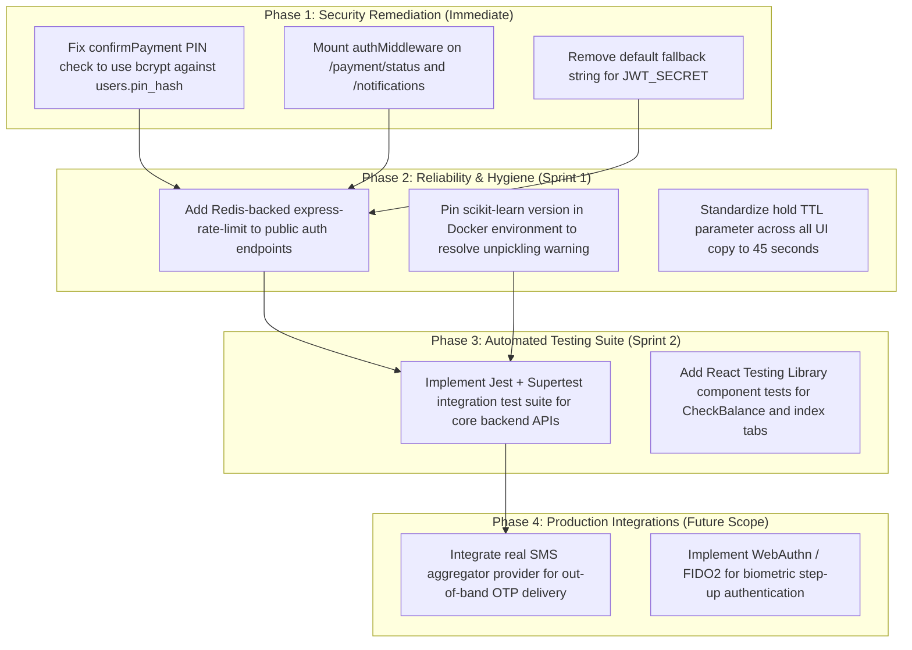

# ApexPay - Master Project Gap Analysis & Feature Status Matrix

This document provides a definitive gap analysis for **ApexPay – Secure Payment Gateway**. In accordance with the strict auditing rules of this investigation, it cross-checks written documentation, commit logs, and README claims against the **actual implemented source code**.

Every system capability is classified into one of four verified categories:
1. **Fully Implemented (`IMPLEMENTED`):** Code exists, is fully wired, verified, and operational.
2. **Partially Implemented (`PARTIAL`):** Functional logic exists but contains simulations, hardcoded values, or incomplete integrations.
3. **Planned / Missing (`MISSING`):** Documented or conceptualized in architectural notes, but absent from actual code.
4. **Simulation Artifact (`SIMULATED`):** Intentionally simulated for academic demonstration and testing.

---

## 1. Comprehensive System Feature Matrix

| Functional Area | Feature / Capability | Implementation Status | Verified Source Evidence | Implementation Details & Technical Gaps |
|---|---|:---:|---|---|
| **Authentication** | Central Bank Verification Onboarding | `IMPLEMENTED` | `authService.ts`, `authController.ts` | Checks presence of mobile number in simulated `bank_accounts` before permitting account registration. |
| **Authentication** | 2FA Mobile OTP Issuance & Verification | `IMPLEMENTED` | `otpService.ts`, `redis.ts` | 6-digit OTPs hashed via SHA-256 in Redis with 300s TTL and 3-attempt lockout. |
| **Authentication** | Bcrypt PIN Hashing (10 Salt Rounds) | `IMPLEMENTED` | `authService.ts` | Permanent PIN hashed during registration and stored in `users.pin_hash`. |
| **Authentication** | JWT Stateless Token Issuance (24h) | `IMPLEMENTED` | `authService.ts`, `authMiddleware.ts` | Signs HMAC SHA-256 JWT containing `userId`, `mobile`, and `name`. Enforced via `authMiddleware`. |
| **Authentication** | SMS Gateway Integration | `SIMULATED` | `otpService.ts`, `backend.ts` | OTPs are generated and stored in Redis, but returned to the client via `otpDebug` response field rather than sent via physical SMS gateway (Twilio / Fast2SMS). |
| **Authentication** | WebAuthn / Biometric Verification | `MISSING` | UI text only | Mentioned in UI copy ("Biometric / MPIN verification"), but no WebAuthn or FIDO2 browser APIs are implemented. |
| **Core Banking** | Central Bank Registry Simulation | `IMPLEMENTED` | `bankService.ts`, `bankPage.tsx` | Full portal enabling creation and listing of core banking accounts (`bank_accounts`) with Aadhar, IFSC, and balance. |
| **Payment Engine** | VPA-Based Payment Addressing | `IMPLEMENTED` | `paymentService.ts`, `vpas` table | Resolves `username@bank` addresses to internal account and user IDs. |
| **Payment Engine** | Mobile-Based Payment Addressing | `IMPLEMENTED` | `paymentService.ts`, `accountController.ts` | Automatically resolves payee's primary VPA and account when payer submits a 10-digit mobile number. |
| **Payment Engine** | Pre-Initiation Payee Resolution | `IMPLEMENTED` | `accountController.ts`, `backend.ts` | `GET /account/resolve` returns recipient's legal name before confirmation to prevent misdirected transfers. |
| **Payment Engine** | Dynamic Behavioral Profiling | `IMPLEMENTED` | `behaviorService.ts` | Queries PostgreSQL for 24h velocity and 30-day mean/standard deviation; checks 30-day device and location anchors in Redis. |
| **Payment Engine** | Distributed Concurrency Locking | `IMPLEMENTED` | `redis.ts`, `paymentService.ts` | Atomically locks sender user ID via Redis `SET user_lock:<id> <token> NX PX 8000` with Lua comparison unlock script. |
| **Payment Engine** | In-Flight Balance Reservation | `IMPLEMENTED` | `reserveService.ts` | Reserves held funds in Redis (`reserve:account:<id>`) under distributed lock to prevent double-spending during 45s hold. |
| **Payment Engine** | Two-Phase Ledger Settlement | `IMPLEMENTED` | `paymentService.ts` | Phase 1 (Debit Sender) sets `failure_reason = 'SENDER_DEBITED'`. Phase 2 (Credit Receiver) updates status to `'COMPLETED'`. |
| **Payment Engine** | Crash Recovery & Idempotent Resume | `IMPLEMENTED` | `paymentService.ts`, `index.ts` | Background cron sweeps every 5s. Resumes Phase 2 credit without re-debiting if `failure_reason == 'SENDER_DEBITED'`. |
| **Payment Engine** | Automated Rollback & Refund | `IMPLEMENTED` | `paymentService.ts` | Reconciles stuck transactions after 3 failed attempts: credits sender balance back, sets status `'FAILED'`, releases reservation. |
| **Payment Engine** | Automatic Step-Up Hold Expiration | `IMPLEMENTED` | `paymentService.ts`, `index.ts` | Background cron sweeps every 5s for transactions where `status == 'HOLD'` and `hold_expires_at < now()`; marks `'FAILED'` and releases funds. |
| **Payment Engine** | Step-Up PIN Verification | `PARTIAL` | `paymentService.ts` (Line 285) | **Critical Gap:** Holds are confirmed via `confirmPayment`, but PIN is verified against hardcoded string `1234` rather than user's `pin_hash`. |
| **Security & Audit** | Immutable Regulatory Audit Logging | `IMPLEMENTED` | `schema.sql`, `auditService.ts` | Database triggers physically block `UPDATE` and `DELETE` on `audit_logs` and `risk_scores`. |
| **Security & Audit** | SQL Injection Defense | `IMPLEMENTED` | `db.ts`, all services | 100% of SQL statements utilize parameterized queries (`$1, $2`). |
| **Security & Audit** | Overdraft Prevention | `IMPLEMENTED` | `schema.sql` | `CHECK (balance >= 0)` on `accounts` and `bank_accounts` enforced at the database storage engine layer. |
| **Security & Audit** | Public Status & Notification Endpoints | `PARTIAL` | `paymentRoutes.ts`, `notificationRoutes.ts` | `/payment/status` and `/notifications` lack `authMiddleware`, exposing transaction status and user alerts to unauthenticated probing. |
| **Machine Learning**| Heuristic Rule Engine (Layer 1) | `IMPLEMENTED` | `risk_rules.py` | Tiered transfer amounts, statistical baseline z-scores, velocity checks, device/location jumps, receiver reputation, periodic pattern discounts. |
| **Machine Learning**| Calibrated Random Forest (Layer 2) | `IMPLEMENTED` | `train.py`, `predict.py` | 150-tree Random Forest with Platt sigmoid calibration (`CalibratedClassifierCV`) evaluating 17 standardized features. |
| **Machine Learning**| Directed Multigraph Engine (Layer 3) | `IMPLEMENTED` | `graph_engine.py`, `graph_rules.py` | In-memory directed multigraph with SQLite WAL persistence, discrete time-window velocities (1h, 24h, 7d), bounded cycle DFS, and mule fan-in detection. |
| **Machine Learning**| Multi-Signal Confirmation & Gating | `IMPLEMENTED` | `integration.py` | Adaptive weighted score blending, smart force overrides for critical account takeovers, false-positive dampening, and 3-tier gating (`LOW`, `MEDIUM`, `HIGH`). |
| **Machine Learning**| Model Training Pipeline | `IMPLEMENTED` | `train.py`, `test_data_large.csv` | Train script executes 5-fold cross validation, sigmoid calibration, and metric evaluation. Verified metrics: 98.53% accuracy, 0.9741 F1-score. |
| **Machine Learning**| Scikit-Learn Compatibility | `PARTIAL` | `risk_model.joblib` | Model pickled under Scikit-Learn 1.9.1; runtime generates unpickling version warnings under 1.5.1. |
| **Frontend UI** | Multi-Tab Payment Dashboard | `IMPLEMENTED` | `pages/index.tsx` | Fully functional Single Page Application with tabs for VPA transfer, Mobile transfer, Balance check, and History. |
| **Frontend UI** | Dynamic Step-Up Hold Countdown | `IMPLEMENTED` | `pages/index.tsx` | Real-time countdown timer tracking 45-second hold deadline with interactive challenge OTP input. |
| **Frontend UI** | Separate Next.js Pages Structure | `MISSING` | `pages/` directory | README / documentation notes suggest separate files (`loginPage.tsx`, `registerPage.tsx`, etc.), but code implements them as integrated tabs/modals inside `pages/index.tsx`. |
| **Frontend UI** | Secure Balance PIN Shield | `IMPLEMENTED` | `components/CheckBalance.tsx` | Interactive PIN entry shield preventing balance exposure until PIN is cryptographically verified by backend. |
| **Testing** | ML Regression Test Suite | `IMPLEMENTED` | `test_service_comprehensive.py` | 13 automated test categories covering normal payments, account takeover, cold starts, social triangles, laundering rings, mule fan-ins, and latency. |
| **Testing** | Chaos Engineering Injection | `IMPLEMENTED` | `testController.ts`, `chaosService.ts` | Allows injecting simulated network delay and server crash points (`BEFORE_DEBIT`, `AFTER_DEBIT`, `BEFORE_CREDIT`) into Redis state. |
| **Testing** | Backend Unit / Integration Tests | `MISSING` | `backend/` | No automated Jest or Mocha test suites are configured or implemented in `backend/package.json`. |
| **Testing** | Frontend Automated Tests | `MISSING` | `frontend/` | No automated React Testing Library or Cypress test suites exist in `frontend/`. |

---

## 2. Key Documentation vs. Code Discrepancies

During our systematic repository audit, the following specific discrepancies between existing documentation (README files, comments, run notes) and actual code were uncovered:

### Discrepancy 1: Frontend Architecture (Separate Pages vs. SPA State Machine)
- **Documented Conception:** Earlier development logs and notes describe modular pages such as `loginPage.tsx`, `registerPage.tsx`, `transactionPage.tsx`, `notificationPage.tsx`, and `securityCheck.tsx`.
- **Actual Code Reality:** In the current repository, only `pages/index.tsx` and `pages/bankPage.tsx` exist. The entire authentication workflow (login, register, OTP, PIN), payment flow (`INPUT` -> `CONFIRM_RECEIVER` -> `ENTER_PIN` -> `FINAL_CONFIRM`), step-up challenge modal, transaction history receipt modal, and notification feeds are all consolidated into a single unified state machine inside [`frontend/pages/index.tsx` (1,353 lines)](file:///s:/Projects/Next.js-Projects/Apexpay_Majorproject/ApexPay/frontend/pages/index.tsx).

### Discrepancy 2: PIN Validation in Hold Confirmation
- **Documented Conception:** Step-up authentication confirms that the legitimate account owner is authorizing the held payment by requiring their secure account PIN alongside the SMS OTP.
- **Actual Code Reality:** While payment initiation (`/payment/initiate`) and balance checking (`/account/balance`) perform authentic `bcrypt.compare` checks against `users.pin_hash`, [`paymentService.ts` (Line 285)](file:///s:/Projects/Next.js-Projects/Apexpay_Majorproject/ApexPay/backend/services/paymentService.ts#L285) contains `if (args.pin.trim() !== "1234") throw new Error("PIN_INVALID");`. This was left as a temporary testing shortcut.

### Discrepancy 3: Biometric / MPIN Copy vs. Implementation
- **Documented Conception:** UI copy and README headers state: *"Held for 60-second secondary challenge (OTP / Biometric / MPIN verification)"*.
- **Actual Code Reality:** The secondary challenge is strictly a 6-digit numeric OTP stored in Redis and confirmed with a PIN. No WebAuthn or device biometric hardware APIs are integrated. The hold TTL is configured to **45 seconds** (`HOLD_TTL_SECONDS = 45`), not 60 seconds.

### Discrepancy 4: SMS Gateway Dispatch vs. Debug Property
- **Documented Conception:** *"System dispatches an SMS OTP to the user's registered mobile device"*.
- **Actual Code Reality:** No third-party SMS aggregator (e.g. Twilio, AWS SNS, Gupshup) is integrated. The generated OTP is returned directly in the JSON response envelope under `otpDebug` for simulator demonstration.

---

## 3. Prioritized Engineering Remediation Plan

To transition ApexPay from a major project prototype to an enterprise-grade payment gateway, the following remediation tasks are recommended:

