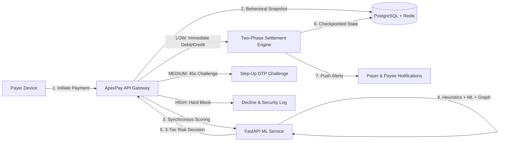
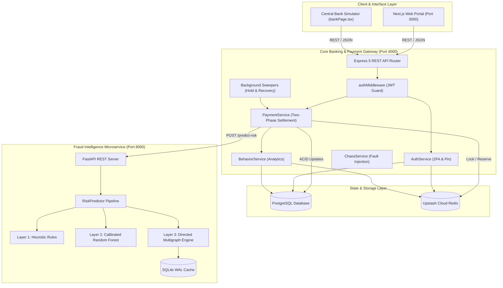
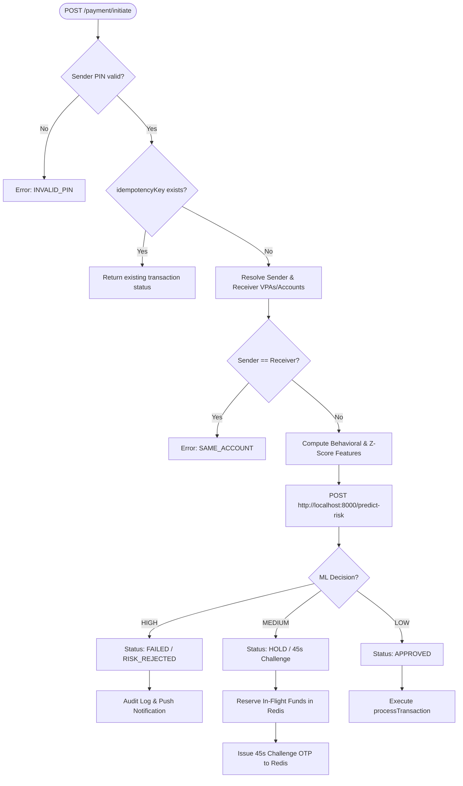

# APEXPAY: SECURE PAYMENT GATEWAY WITH INTELLIGENT REAL-TIME FRAUD DETECTION & FAULT-TOLERANT SETTLEMENT

## MASTER TECHNICAL REFERENCE & ENGINEERING SPECIFICATION

**Project Repository:** `https://github.com/Shaikh-Aasim/ApexPay`  
**Project Type:** Final Year Major Project (B.E. Computer Engineering)  
**Authors & Team Members:**
- **Sujal Dingankar**
- **Aasim Shaikh**
- **Mohammed Abbas Kazi**

---

# CHAPTER 1: PROJECT OVERVIEW

**ApexPay** is an enterprise-grade, real-time, Unified Payments Interface (UPI)-style instant payment gateway engineered to resolve the twin challenges of modern digital payment ecosystems: **pre-settlement financial fraud** and **distributed transaction inconsistency during network or server crashes**.

Traditional instant payment switches (e.g., UPI, IMPS, SEPA Instant) operate on synchronous fund transfer rails where transactions are settled in milliseconds. However, conventional financial fraud management systems evaluate transactions *post-settlement* (in batch runs or asynchronous risk queues) or rely on rigid, rule-based static thresholds that produce high false-positive rates, frustrating legitimate customers.

ApexPay introduces an integrated, multi-tier architectural framework comprising:
1. A **Next.js & React Frontend** single-page payment portal featuring a zero-trust balance shield, real-time step-up countdown timers, and an interactive Central Bank Registry simulator.
2. A **Node.js & Express Core Banking Gateway** coordinating two-phase distributed settlement, Redis-based mutual exclusion locking, in-flight fund reservations, and background recovery sweeps.
3. An **Intelligent Pre-Settlement Python FastAPI Microservice** executing a three-layer hybrid fraud detection model (Heuristic Rules + Calibrated Random Forest + Directed Multigraph Intelligence) in the synchronous pre-authorization path ($< 25\text{ ms}$ latency).
4. A **PostgreSQL Relational Ledger** enforcing relational integrity, overdraft checks (`CHECK (balance >= 0)`), and immutable regulatory audit triggers.
5. An **Upstash Redis Caching & Distributed Locking Layer** handling sub-millisecond atomic locks, SHA-256 ephemeral OTP verification, and behavioral anchors.

---

# CHAPTER 2: PROBLEM STATEMENT

Modern digital payment architectures in rapid-growth fintech economies face three severe vulnerabilities:

1. **Pre-Settlement Blindness:** Most fraud detection solutions operate out-of-band. Once a fraudulent transaction is authorized and ledger balances are committed, fund recovery becomes an expensive, slow, and often futile inter-bank dispute process.
2. **False Positives vs. Security Friction:** Simple threshold rules (e.g., blocking any transfer $> \text{₹}20,000$ or blocking any transaction from a new device) disproportionately burden legitimate users, driving customer churn. Systems lack contextual risk scoring to differentiate between high-risk anomalies and benign behavioral adjustments (e.g., salary payments, bill-splitting among friends).
3. **Partial Failure Inconsistency in Distributed Ledgers:** In distributed settlement systems, if a server or network connection fails after debiting the payer's bank account but before crediting the payee's account, the system enters an indeterminate state. Without rigorous two-phase settlement checkpoints and automated reconciliation workers, customer funds disappear into limbo, causing financial disputes.

---

# CHAPTER 3: MOTIVATION AND BACKGROUND

The Indian digital payments landscape, anchored by NPCI's Unified Payments Interface (UPI), processes over 14 billion transactions monthly. However, this explosive growth has coincided with sophisticated cyber threats:
- **Account Takeover (ATO):** Fraudsters gain credential access and rapidly drain balances from uncharacteristic geographic locations using unrecognized devices.
- **Mule Account Funneling:** Criminal syndicates create "mule" accounts that receive dozens of small-to-medium transfers within hours, which are immediately withdrawn at ATMs to launder stolen funds.
- **Circular Laundering Rings:** Stolen funds are routed through a chain of accounts ($A \to B \to C \to D \to A$) to obscure provenance.

Motivated by these real-world systemic threats, the ApexPay project was designed to implement a production-grade, pre-settlement defense mechanism combined with a fault-tolerant two-phase settlement engine, demonstrating that advanced machine learning and graph topology algorithms can operate synchronously within real-time payment SLAs.

---

# CHAPTER 4: PROJECT OBJECTIVES

1. **Pre-Settlement Risk Evaluation:** Evaluate every incoming transaction synchronously across 17 behavioral, topological, and environmental features before committing ledger updates.
2. **Three-Tier Intelligent Decision Gating:**
   - **`LOW` (Auto-Approve):** Risk score in $[0.00, 0.42)$ $\implies$ Zero user friction, instantaneous settlement.
   - **`MEDIUM` (Step-Up Challenge):** Risk score in $[0.42, 0.75)$ $\implies$ 45-second hold with out-of-band OTP verification to confirm legitimate intent.
   - **`HIGH` (Hard Block):** Risk score in $[0.75, 1.00]$ $\implies$ Non-negotiable transaction rejection and audit alerting.
3. **Graph Intelligence & Laundering Ring Detection:** Detect circular laundering rings ($\ge 5$ nodes) and money mule fan-in funnels ($\ge 10$ senders in 24h), while exempting legitimate social triangles ($3$ nodes, bill splitting).
4. **Crash Resilience & Two-Phase Settlement:** Split settlement into discrete, recoverable phases: Phase 1 (Sender Debit) with checkpointing (`failure_reason = 'SENDER_DEBITED'`) followed by Phase 2 (Receiver Credit). If a server crashes midway, a background recovery worker resumes Phase 2 without double-debiting.
5. **Zero-Trust Security & Immutability:** Enforce bcrypt PIN hashing, distributed mutual exclusion locks, in-flight fund reservations, and database-level immutability triggers on financial audit logs.

---

# CHAPTER 5: SCOPE OF THE PROJECT

### In Scope:
- Complete end-to-end payment gateway lifecycle: registration, 2FA login, bank account linking, payment initiation, fraud assessment, two-phase settlement, hold verification, and transaction history.
- Core Banking Registry simulation (`bank_accounts`) representing the national central banking authority (CBS/NPCI).
- Synchronous ML microservice with heuristic rules, Platt-calibrated Random Forest ensemble, directed multigraph engine, and persistent SQLite WAL cache.
- Concurrency control via distributed Redis Redlock algorithms and in-flight balance reservations.
- Fault injection and chaos engineering harness (`/test/delay`, `/test/crash`, `/test/settlement-failure`).

### Out of Scope (Current Major Project Scope):
- Physical hardware HSM (Hardware Security Module) key management.
- Production third-party SMS aggregator integration (simulated via Redis with `otpDebug`).
- Direct integration with real NPCI / ISO 8583 switch protocols.

---

# CHAPTER 6: EXISTING SYSTEM AND ITS LIMITATIONS

| Existing System Characteristics | Limitations & Vulnerabilities in Existing Solutions |
|---|---|
| **Post-Settlement Fraud Scoring** | Fraud scoring occurs asynchronously minutes or hours after ledger settlement. Fraudulent funds are already withdrawn by the attacker. |
| **Static Threshold Rules** | Fails to account for user history. A ₹20,000 transfer by a high-net-worth user is flagged identically to a ₹20,000 transfer by a student account. |
| **Lack of Topological Awareness** | Relational databases inspect single transactions in isolation. They cannot detect multi-node money laundering rings or funneling networks. |
| **Monolithic State Machines** | Many commercial systems rollback all debit operations upon failure, causing customer confusion when network drops occur during inter-bank communication. |
| **Mutable Audit Trails** | Standard database implementations allow database administrators or compromised services to alter transaction and audit records. |

---

# CHAPTER 7: PROPOSED SYSTEM

ApexPay replaces fragmented post-settlement architectures with a unified, real-time defense framework:



### Key Advantages of Proposed Architecture:
1. **Synchronous Pre-Authorization:** High-confidence fraud prevention before ledger mutation.
2. **Calibrated Probabilities:** Ensemble probabilities are calibrated using Platt sigmoid scaling, representing empirical posterior probabilities $P(\text{Fraud} = 1 \mid \mathbf{x})$.
3. **Graph Intelligence:** Identifies complex laundering rings and mule aggregation patterns in real time.
4. **Idempotent Fault Tolerance:** Automatic retry recovery sweeps and rollback reconciliation guarantee that no customer funds are lost during server crashes.

---

# CHAPTER 8: FUNCTIONAL REQUIREMENTS

- **FR-01: User Registration & Onboarding:** Verify mobile number against Central Bank Registry, issue 6-digit SMS OTP, verify OTP, set permanent 4-to-6 digit PIN, create user profile, link bank account, and map default VPA.
- **FR-02: Two-Factor Authentication Login:** Authenticate registered users via 6-digit login OTP (factor 1) followed by bcrypt PIN verification (factor 2), issuing a 24-hour JWT token.
- **FR-03: Central Bank Registry Management:** Provide an administrative portal to create and inspect simulated bank accounts (`bank_accounts`) with Aadhar numbers, account numbers, IFSC codes, and balances.
- **FR-04: Dual-Mode Payment Addressing:** Support payments initiated either by Virtual Payment Address (e.g., `isha@neo`) or 10-digit mobile number (e.g., `9000000002`).
- **FR-05: Pre-Initiation Payee Resolution:** Return payee legal name and primary VPA prior to transaction submission to avoid transfer errors.
- **FR-06: Real-Time Fraud & Risk Scoring:** Evaluate 17 behavioral, environmental, and topological features per transaction, generating a bounded score in $[0.0, 1.0]$ and an authoritative tier (`LOW`, `MEDIUM`, `HIGH`).
- **FR-07: In-Flight Balance Reservation:** Temporarily reserve held funds in Redis to prevent double-spending during step-up challenges.
- **FR-08: Step-Up Authentication Challenge:** Suspend anomalous (`MEDIUM`) transactions in `HOLD` status for 45 seconds; auto-expire if unverified.
- **FR-09: Two-Phase Distributed Settlement:** Execute separate sender debit and receiver credit phases with intermediate checkpointing (`failure_reason = 'SENDER_DEBITED'`).
- **FR-10: Background Recovery & Rollback Workers:** Periodically sweep stuck `APPROVED` transactions; resume Phase 2 credit up to 3 retries, or refund the sender and mark `FAILED`.
- **FR-11: Secure Balance Inquiry:** Shield account balances behind an active cryptographic PIN check.
- **FR-12: Full Chronological Ledger History:** Provide filterable transaction history with full sender/receiver bank metadata.
- **FR-13: In-App Event Notifications:** Dispatch real-time alerts for debits, credits, holds, refunds, and security declines.

---

# CHAPTER 9: NON-FUNCTIONAL REQUIREMENTS

- **NFR-01: Low Latency & High Throughput:** Pre-settlement risk scoring must complete within $< 30\text{ ms}$ ($p50 < 25\text{ ms}$, $p95 < 50\text{ ms}$). Overall payment initiation must respond within $< 200\text{ ms}$.
- **NFR-02: High Fraud Recall & Precision:** Model recall $\ge 98.0\%$ to capture financial threats, combined with false-positive filtering to keep customer friction below $1.0\%$.
- **NFR-03: Data Consistency & ACID Compliance:** All ledger movements must enforce strict ACID properties; negative balances are physically blocked via database constraints.
- **NFR-04: High Availability & Fault Tolerance:** In the event of backend node crashes, background workers must reconcile indeterminate transactions within 10 seconds of recovery.
- **NFR-05: Security & Regulatory Compliance:** Bcrypt PIN hashing with 10 salt rounds; immutable audit logs protected by PL/pgSQL database triggers.
- **NFR-06: Scalability & Memory Efficiency:** Graph engine employs discrete time windows and memory-bounded DFS to prevent exponential explosion.

---

# CHAPTER 10: COMPLETE TECHNOLOGY STACK

```
┌────────────────────────────────────────────────────────────────────────┐
│ 1. Frontend: Next.js 16.2.4 | React 19.2.4 | Tailwind CSS 4.2.4        │
├────────────────────────────────────────────────────────────────────────┤
│ 2. Backend: Node.js 22.22.2 | Express 5.2.1 | TypeScript 6 | Zod 4.3.6  │
├────────────────────────────────────────────────────────────────────────┤
│ 3. Database: PostgreSQL 14+ (Supabase) | pgcrypto | Immutable Triggers  │
├────────────────────────────────────────────────────────────────────────┤
│ 4. Cache & Locks: Upstash Cloud Redis REST | Redlock Lua Scripting     │
├────────────────────────────────────────────────────────────────────────┤
│ 5. ML Service: Python 3.12.4 | FastAPI 0.116 | Scikit-Learn | SQLite   │
└────────────────────────────────────────────────────────────────────────┘
```
*(For detailed dependency versions and package descriptions, see [`TECHNOLOGY_AND_DEPENDENCIES.md`](file:///s:/Projects/Next.js-Projects/Apexpay_Majorproject/project-documentation/TECHNOLOGY_AND_DEPENDENCIES.md)).*

---

# CHAPTER 11: SYSTEM ARCHITECTURE

ApexPay implements a microservices architecture separating core transaction processing from machine learning inference:



---

# CHAPTER 12: FRONTEND ARCHITECTURE

The frontend is built on **Next.js 16.2.4** and **React 19.2.4** using the Pages Router.

### Architectural Structure:
- `pages/_app.tsx`: Root wrapper importing Tailwind CSS v4 design tokens.
- `pages/index.tsx`: Main application dashboard (1,353 LOC). Houses a client-side state machine managing:
  - **Auth Modals:** Multi-step Login (Mobile $\to$ OTP $\to$ PIN) and Registration (Mobile $\to$ Central Bank Check $\to$ OTP $\to$ Bank Selection $\to$ PIN).
  - **Payment Workflow:** 4-stage pipeline (`INPUT` $\to$ `CONFIRM_RECEIVER` $\to$ `ENTER_PIN` $\to$ `FINAL_CONFIRM`).
  - **Step-Up Hold Modal:** Displays a live 45-second countdown timer, OTP challenge input, and payment cancel button.
  - **Transaction History:** Real-time filterable ledger view with modal receipts.
  - **Chaos Testing Controls:** Interactive dropdown to inject simulated server crashes (`AFTER_DEBIT`, `BEFORE_CREDIT`).
- `pages/bankPage.tsx`: Standalone Central Bank Registry simulator to register simulated customer accounts with Aadhar and initial balance.
- `components/CheckBalance.tsx`: PIN shield widget ensuring account balance is only rendered upon PIN verification.
- `services/backend.ts`: Type-safe HTTP connector injecting Bearer JWT tokens from `localStorage` into all backend requests.

---

# CHAPTER 13: BACKEND ARCHITECTURE

The backend is built with **Node.js 22** and **Express 5.2.1** written in strict **TypeScript 6**.

### Layered Structure:
1. **HTTP / Routing Layer (`backend/routes/`):** Defines clean REST endpoints mounted at `/api/auth`, `/api/bank`, `/payment`, `/account`, `/notifications`, and `/test`.
2. **Controller Layer (`backend/controllers/`):** Validates request bodies against strict Zod schemas and translates service exceptions into standardized JSON error envelopes.
3. **Middleware Layer (`backend/middleware/`):** `authMiddleware.ts` intercepts requests, validates Bearer JWT signatures with `JWT_SECRET`, and injects verified user identity into `req.user`.
4. **Service Layer (`backend/services/`):** Implements business logic (payment processing, distributed locking, in-flight fund reservation, behavioral analytics).
5. **Persistence & Utility Layer (`backend/utils/`):** `db.ts` (connection pooling), `redis.ts` (Upstash REST client, Redlock mutex), and `migrate.ts` (database schema migration at startup).

---

# CHAPTER 14: DATABASE DESIGN

The relational schema is implemented in **PostgreSQL** (`ApexPay/database/schema.sql`). It enforces:
- **Cryptographic UUIDs:** Default primary keys generated via `pgcrypto` (`gen_random_uuid()`).
- **Domain Constraints:** Checks ensuring `balance >= 0` on `accounts` and `bank_accounts`, and `amount > 0` on `transactions`.
- **Relational Integrity:** Foreign keys linking users, banks, accounts, VPAs, receiver profiles, risk scores, transactions, and audit logs.
- **Immutability Protection:** Procedural PL/pgSQL triggers blocking modification of compliance records.

*(For full schema DDL, constraints, and relational mappings, consult [`DATABASE_DOCUMENTATION.md`](file:///s:/Projects/Next.js-Projects/Apexpay_Majorproject/project-documentation/DATABASE_DOCUMENTATION.md)).*

---

# CHAPTER 15: DATABASE TABLES AND RELATIONSHIPS

The database comprises 10 core relational entities:

```
┌─────────────────────┬──────────────────────────────────────────────────────────┐
│ Table Name          │ Core Responsibility & Relationships                      │
├─────────────────────┼──────────────────────────────────────────────────────────┤
│ `banks`             │ Registry of supported banks ('Apex Bank', 'Neo Bank').   │
│ `bank_accounts`     │ Simulated Central Bank Registry (CBS source of truth).   │
│ `users`             │ User profiles, mobile numbers, and bcrypt pin_hash.       │
│ `accounts`          │ Internal linked wallet/bank balance per user.            │
│ `vpas`              │ UPI-style addressing: unique VPA -> account/user/bank.    │
│ `receiver_profiles` │ Recipient historical suspicion score and blacklist flag. │
│ `transactions`      │ Central transaction ledger tracking lifecycle states.     │
│ `risk_scores`       │ Immutable audit log of ML risk inference snapshots.      │
│ `audit_logs`        │ Immutable audit trail of actor and system operations.    │
│ `notifications`     │ User notification messages for in-app alert feeds.       │
└─────────────────────┴──────────────────────────────────────────────────────────┘
```

---

# CHAPTER 16: REDIS ARCHITECTURE AND IMPLEMENTATION

ApexPay uses **Upstash Cloud Redis** via HTTP REST to eliminate persistent TCP socket exhaustion while guaranteeing sub-millisecond ephemeral operations:

### Key Patterns & TTL Mappings:
1. **SMS OTP Tokens:**
   - Registration: `otp:register:<mobile>` $\to$ SHA-256 hash, attempts count, `TTL = 300s`.
   - Login: `otp:login:<mobile>` $\to$ SHA-256 hash, attempts count, `TTL = 300s`.
   - Payment Challenge: `otp:txn:<txnId>` $\to$ SHA-256 hash, attempts count, `TTL = 45s`.
2. **Pre-Clearance Session Flags:**
   - Registration clearance: `otp:verified:register:<mobile> = "true"`, `TTL = 600s`.
   - Login clearance: `login:otp_verified:<mobile> = "true"`, `TTL = 300s`.
3. **Distributed Mutual Exclusion (Redlock):**
   - Lock Key: `user_lock:<sender_user_id>` $\to$ Random 16-byte hex token, `TTL = 8000ms`.
   - Acquired via `SET key value NX PX 8000`. Released via atomic Lua script:
     ```lua
     if redis.call("get", KEYS[1]) == ARGV[1] then 
       return redis.call("del", KEYS[1]) 
     else 
       return 0 
     end
     ```
4. **In-Flight Balance Reservation:**
   - Key: `reserve:account:<accountId>` $\to$ Numeric string tracking reserved currency, `TTL = 3600s`.
   - Enforces `current_reserved + amount <= balanceLimit` to prevent double-spending during 45s holds.
5. **Behavioral Anchors:**
   - `user:last_device:<userId>` $\to$ Device fingerprint string, `TTL = 30 days`.
   - `user:last_location:<userId>` $\to$ Geolocation string, `TTL = 30 days`.
6. **Chaos Engineering Flags:**
   - `chaos:delay_ms` $\to$ Latency in ms, `TTL = 60s`.
   - `chaos:crash_point` $\to$ Crash point (`BEFORE_DEBIT`, `AFTER_DEBIT`, `BEFORE_CREDIT`), `TTL = 60s`.

---

# CHAPTER 17: AUTHENTICATION AND AUTHORIZATION

ApexPay enforces multi-factor authentication across user onboarding and session management:

### 1. Onboarding Pipeline:
1. **Step 1 (`/register/initiate`):** Validates mobile presence in Central Bank Registry (`bank_accounts`). Generates 6-digit random OTP, hashes via SHA-256, stores in Redis.
2. **Step 2 (`/register/verify-otp`):** Compares SHA-256 hash in Redis. Tracks failed attempts (lockout at 3). Sets verification flag `otp:verified:register:<mobile>` with 600s TTL.
3. **Step 3 (`/register/set-pin`):** Verifies clearance flag. Hashes PIN using `bcrypt.hash(pin, 10)`. Creates user, wallet, and default VPA (`name1234@apex`) in a single SQL transaction.

### 2. Login Pipeline:
1. **Step 1 (`/login/initiate`):** Verifies user existence, issues 6-digit OTP to Redis (`TTL = 300s`).
2. **Step 2 (`/login/verify-otp`):** Verifies OTP, sets temporary pre-clearance flag `login:otp_verified:<mobile>` (`TTL = 300s`).
3. **Step 3 (`/login/verify-pin`):** Verifies pre-clearance flag. Compares PIN against `users.pin_hash` via `bcrypt.compare`. Issues HMAC SHA-256 signed JWT token containing `{ userId, mobile, name }` with 24-hour expiration.

---

# CHAPTER 18: PAYMENT PROCESSING ENGINE

The payment processing engine (`ApexPay/backend/services/paymentService.ts`) coordinates risk evaluation, concurrency control, and ledger settlement:



---

# CHAPTER 19: FRAUD DETECTION AND RISK ASSESSMENT

Fraud detection operates on an **Integrated Multi-Signal Decision Matrix** across 17 standardized features:

### Canonical Feature Register:
1. `amount`: Transfer magnitude in INR ($> 0$).
2. `txn_count_24h`: Transaction velocity over past 24 hours.
3. `device_change`: Binary flag ($1$ if device hardware changed, else $0$).
4. `location_anomaly`: Binary flag ($1$ if geolocation changed, else $0$).
5. `receiver_flagged`: Binary blacklist flag ($1$ if receiver is blacklisted).
6. `receiver_suspicion_score`: Receiver historical chargeback rate in $[0.0, 1.0]$.
7. `user_avg_amount_30d`: Payer 30-day mean transaction value.
8. `user_std_amount_30d`: Payer 30-day standard deviation.
9. `amount_zscore`: Statistical deviation:
   $$Z = \frac{\text{amount} - \mu_{30d}}{\sigma_{30d}}$$
10. `is_first_transaction`: Boolean flag indicating payer's first lifetime transfer.
11. `user_total_txn`: Total lifetime transactions by payer.
12. `account_age_hours`: Elapsed hours since account creation.
13. `is_periodic_pattern`: Boolean flag confirming recurring transfers (rent, salaries, utility bills).
14. `day_of_month`: Calendar day $[1, 31]$.
15. `relationship_stability_score`: Transfer frequency ratio between this specific sender-receiver pair in $[0.0, 1.0]$.
16. `is_high_amount_global`: Transfer $\ge 95\text{th}$ percentile of platform-wide volume.
17. `amount_percentile_global`: Global relative percentile rank in $[0.0, 1.0]$.

---

# CHAPTER 20: MACHINE LEARNING SERVICE

Implemented in **Python 3.12** with **FastAPI** (`ApexPay/ml-service/`):

### The Three-Layer Detection Architecture:
1. **Layer 1: Heuristic Rule Engine (`utils/risk_rules.py`):**
   - Tiered amount baselines, velocity limits, credential anomaly detection.
   - Legitimacy discounts: $-0.18$ for periodic recurring patterns, $-0.20$ for high relationship stability ($> 0.75$).
2. **Layer 2: Calibrated Random Forest Ensemble (`training/train.py`, `api/predict.py`):**
   - 150 decision trees, maximum depth 10, minimum leaf samples 4, balanced class weighting.
   - Probability calibration via Platt scaling (`CalibratedClassifierCV(method='sigmoid', cv=3)`), mapping raw ensemble votes to empirical posterior probabilities.
   - Performance metrics: **Accuracy: 98.53%**, **Precision: 96.11%**, **Recall: 98.75%**, **F1-Score: 0.9741**.
3. **Layer 3: Graph Intelligence Engine (`utils/graph_engine.py`, `utils/graph_rules.py`):**
   - In-memory directed multigraph backed by persistent SQLite Write-Ahead Logging (`WAL`) mode.
   - Exact discrete time-window velocities (1h, 24h, 7d, lifetime).
   - Bounded Cycle DFS: detects circular laundering rings ($\ge 5$ nodes, risk $0.95$) while exempting social bill splitting ($3$ nodes, risk $0.05$).
   - Mule Fan-In Funnel: flags accounts receiving funds from $\ge 10$ unique senders in 24h (risk $0.95$).
   - Temporal neighbor risk decay with a **14-day half-life**:
     $$\text{decay} = 0.5^{\frac{\Delta t}{14 \times 86400}}$$

### Adaptive Score Fusion:
Scores are synthesized using adaptive weighting:
$$S_{\text{final}} = w_{\text{ML}} S_{\text{ML}} + w_{\text{rule}} S_{\text{rule}} + w_{\text{graph}} S_{\text{graph}}$$
- If $S_{\text{ML}} < 0.25$: Weights are $(0.45, 0.30, 0.25)$.
- If $S_{\text{ML}} > 0.75$: Weights are $(0.65, 0.20, 0.15)$.
- Default: Weights are $(0.55, 0.25, 0.20)$.

---

# CHAPTER 21: COMPLETE API DOCUMENTATION

*(For detailed schemas, headers, sample payloads, and status codes across all 15 endpoints, refer to [`PROJECT_API_REFERENCE.md`](file:///s:/Projects/Next.js-Projects/Apexpay_Majorproject/project-documentation/PROJECT_API_REFERENCE.md)).*

### Express Core Backend (`http://localhost:4000`):
- `POST /api/auth/register/initiate`: Initiate onboarding with Central Bank check & OTP.
- `POST /api/auth/register/verify-otp`: Verify onboarding OTP.
- `POST /api/auth/register/set-pin`: Set permanent PIN, create user and VPA.
- `POST /api/auth/login/initiate`: Initiate 2FA login with mobile OTP.
- `POST /api/auth/login/verify-otp`: Verify login OTP.
- `POST /api/auth/login/verify-pin`: Verify PIN and issue JWT token.
- `POST /api/bank/accounts`: Register account in Central Bank simulation.
- `GET  /api/bank/list`: List registered banks.
- `POST /payment/initiate`: Evaluate risk and initiate transaction (`LOW`, `MEDIUM`, `HIGH`).
- `POST /payment/confirm`: Verify step-up OTP and PIN for held transaction.
- `POST /payment/cancel`: Voluntarily cancel a held transaction.
- `GET  /payment/status`: Poll transaction status by ID.
- `GET  /payment/history`: Chronological ledger history for authenticated user.
- `GET  /account/resolve`: Resolve payee legal name and VPA.
- `GET  /account/balance`: Secure balance inquiry requiring PIN verification.
- `GET  /notifications`: Retrieve user in-app notifications.
- `POST /test/delay`, `POST /test/crash`, `POST /test/settlement-failure`: Chaos testing.

### FastAPI ML Microservice (`http://localhost:8000`):
- `GET  /health`: Health check & loaded model version.
- `GET  /metrics`: Cross-validation scores and evaluation metrics.
- `POST /predict-risk`: Synchronous 3-layer risk inference on 17 features.

---

# CHAPTER 22: END-TO-END APPLICATION WORKFLOWS

*(Complete sequence diagrams for all 7 primary workflows are specified in [`SYSTEM_WORKFLOWS.md`](file:///s:/Projects/Next.js-Projects/Apexpay_Majorproject/project-documentation/SYSTEM_WORKFLOWS.md)).*

1. **Central Bank Account Registration Workflow:** Onboards simulated core banking records with Aadhar, IFSC, and opening balance into `bank_accounts`.
2. **User Registration Workflow:** Multi-step verification ensuring mobile existence in `bank_accounts`, verifying SMS OTP via Redis, hashing PIN with bcrypt, creating user wallet, and mapping default VPA.
3. **Two-Factor Authentication Login Workflow:** Enforces possession factor (SMS OTP) followed by knowledge factor (PIN), issuing signed 24h JWT.
4. **Low-Risk Payment Workflow:** Auto-approves payment, acquires Redis user mutex, executes two-phase settlement, updates database ledger, and sends debit/credit alerts.
5. **Step-Up Challenge Payment Workflow:** Places anomalous payment on 45s hold, reserves funds in Redis, prompts user for challenge OTP, and settles upon verification.
6. **Crash Resilience & Recovery Workflow:** Checkpoints settlement progress (`SENDER_DEBITED`). Recovers and completes Phase 2 credit during background sweep.
7. **Secure Balance Inquiry Workflow:** PIN shield requires active bcrypt PIN verification before returning account balance.

---

# CHAPTER 23: TRANSACTION LIFECYCLE

The lifecycle of every transaction is defined by discrete transitions of the `transaction_status` enum:

```
[POST /payment/initiate]
          │
          ▼
     REQUESTED
    ┌─────┼─────────────────────────┐
    │     │                         │
    │     ▼ (Risk == MEDIUM)        ▼ (Risk == HIGH)
    │   HOLD                      FAILED (RISK_REJECTED)
    │     │
    │     ├─────────────────────────┐
    │     ▼ (OTP Verified)          ▼ (Timer Expired / User Cancel)
    ▼     ▼                         ▼
    APPROVED                      FAILED (HOLD_EXPIRED / CANCELED)
          │
          ├─────────────────────────┐
          ▼ (Phase 1 + Phase 2 OK)  ▼ (Crash during settlement)
      COMPLETED                  APPROVED (failure_reason: SENDER_DEBITED)
                                    │
                                    ├──────────────────────┐
                                    ▼ (Sweep Retry OK)     ▼ (Sweep Retries >= 3)
                                RECOVERED               FAILED (ROLLBACK_AFTER_MAX_RETRIES)
                                                        (Sender Refunded)
```

---

# CHAPTER 24: ERROR HANDLING AND RECOVERY

1. **Idempotency Protection:** Incoming requests with duplicate `idempotencyKey` return existing transaction state without re-executing risk models or debit operations.
2. **Crash Point Handling in Two-Phase Settlement:**
   - **Crash `BEFORE_DEBIT`:** Neither account was modified. Transaction remains `APPROVED` with `failure_reason = NULL`. Background recovery worker retries Phase 1 debit and Phase 2 credit safely.
   - **Crash `AFTER_DEBIT` / `BEFORE_CREDIT`:** Sender account was debited; transaction marked with `failure_reason = 'SENDER_DEBITED'`. Recovery worker detects checkpoint, skips debit, and executes Phase 2 credit. Status becomes `RECOVERED`.
3. **Maximum Retry Rollback Reconciliation:** If recovery fails 3 consecutive times (e.g., receiver account deleted or database constraint error), `rollbackTransaction()` refunds the sender (`balance = balance + amount`), sets status to `'FAILED'`, releases reserved funds, and creates a `PAYMENT_REFUNDED` audit log and user notification.
4. **Hold Timeout Sweep:** Every 5 seconds, `expireHolds()` finds transactions where `status = 'HOLD'` and `hold_expires_at < now()`, marks them `'FAILED'` with `failure_reason = 'HOLD_EXPIRED'`, and releases reserved funds from Redis.

---

# CHAPTER 25: SECURITY IMPLEMENTATION

- **Password & PIN Hashing:** 10 salt rounds of bcrypt (`bcrypt.hash(pin, 10)`).
- **Two-Factor Authentication:** Combination of possession factor (ephemeral OTP) and knowledge factor (PIN).
- **Ephemeral OTP Token Hashing:** SHA-256 hashed in Redis; raw OTP never stored in plain text.
- **Stateless Authorization:** HMAC SHA-256 JWT with 24-hour expiration enforced on all sensitive endpoints.
- **Distributed Concurrency Mutex:** Redis `SET NX PX` locking on sender user ID with atomic Lua unlock comparison scripts.
- **Double-Spend Shield:** In-flight fund reservation in Redis during transaction holds.
- **Database Engine Checks:** `CHECK (balance >= 0)` and `CHECK (amount > 0)`.
- **Immutable Regulatory Audit Trails:** PL/pgSQL database triggers blocking `UPDATE` and `DELETE` on `audit_logs` and `risk_scores`.
- **SQL Injection Prevention:** 100% parameterized queries (`$1, $2`).
- **Strict Input Validation:** Zod and Pydantic v2 schemas reject invalid inputs.

---

# CHAPTER 26: TESTING AND VALIDATION

- **Machine Learning Regression Suite (`ml-service/tests/test_service_comprehensive.py`):** 13 automated test categories covering normal payments, account takeovers, cold starts, social triangles, laundering rings, mule fan-ins, discrete time windows, deduplication, super-node prevention, and latency SLAs ($p50 < 300\text{ ms}$). All 13 tests passed.
- **Model Cross-Validation:** 5-fold cross-validation on 50,000 synthetic records: **F1-Score: 0.9741**, **Accuracy: 98.53%**, **Precision: 96.11%**, **Recall: 98.75%**.
- **Chaos Testing Harness:** Implemented in `backend/controllers/testController.ts`, enabling manual and automated injection of delays and crashes (`BEFORE_DEBIT`, `AFTER_DEBIT`, `BEFORE_CREDIT`).
- **Balance & Seeding Verification:** Verified via `add_test_user.ts` and `test_balance.js`.

---

# CHAPTER 27: PROJECT SETUP AND EXECUTION INSTRUCTIONS

### 1. Prerequisites:
- Node.js v20+ (tested on Node v22)
- Python 3.10+ (tested on Python 3.12)
- PostgreSQL database (Supabase or local instance)
- Upstash Redis database (REST URL & Token)

### 2. Service Startup Sequence:

```bash
# Terminal 1: Machine Learning Microservice
cd ApexPay/ml-service
pip install -r requirements.txt
python -m training.train
uvicorn api.main:app --host 0.0.0.0 --port 8000 --reload

# Terminal 2: Core Banking Backend
cd ApexPay/backend
npm install
# Configure backend/.env with DATABASE_URL, UPSTASH_REDIS_REST_URL, UPSTASH_REDIS_REST_TOKEN
npm run dev

# Terminal 3: Frontend Client
cd ApexPay/frontend
npm install
npm run dev
```

The frontend web portal will be accessible at `http://localhost:3000`.

---

# CHAPTER 28: FOLDER AND FILE STRUCTURE EXPLANATION

*(For an exhaustive breakdown of every file, function, and relationship, see [`PROJECT_FILE_INVENTORY.md`](file:///s:/Projects/Next.js-Projects/Apexpay_Majorproject/project-documentation/PROJECT_FILE_INVENTORY.md)).*

```
ApexPay/
├── Run.txt                      # Operational startup notes and flow summaries
├── add_test_user.ts             # Seeding script for test users
├── test_balance.js              # Smoke test script for balance retrieval
├── database/
│   └── schema.sql               # PostgreSQL schema DDL, enums, triggers, and seed data
├── backend/                     # Node.js / Express Core Gateway
│   ├── config/env.ts            # Zod environment variable parsing
│   ├── controllers/             # Express controllers (auth, bank, payment, account, test)
│   ├── middleware/              # authMiddleware.ts (JWT guard)
│   ├── routes/                  # Express route definitions
│   ├── services/                # Business logic (settlement, OTP, reserve, behavior, chaos)
│   └── utils/                   # Database pool, Redis client, schema migrations
├── frontend/                    # Next.js 16 / React 19 Client
│   ├── components/              # CheckBalance.tsx (secure balance shield)
│   ├── pages/                   # index.tsx (SPA dashboard), bankPage.tsx (CBS simulator)
│   ├── services/backend.ts      # Typed HTTP client & JWT injector
│   └── styles/globals.css       # Tailwind CSS v4 styles
└── ml-service/                  # Python FastAPI Risk Engine
    ├── api/                     # main.py (REST API), predict.py (pipeline), integration.py
    ├── data/graph_store.db      # SQLite WAL persistent graph cache
    ├── model/                   # Serialized risk_model.joblib and metrics.json
    ├── training/train.py        # Model training, cross-validation & Platt calibration
    ├── utils/                   # 17-feature vectorizer, heuristic rules, graph engine
    ├── tests/                   # 13-point regression test suite & synthetic generators
    └── docs/                    # Technical deep-dive documentation suite
```

---

# CHAPTER 29: EXTERNAL SERVICES AND INTEGRATIONS

1. **Supabase PostgreSQL:** Managed cloud relational database hosting transaction ledgers, audit logs, and account balances.
2. **Upstash Cloud Redis:** Serverless REST-based in-memory data store managing distributed locks, OTP hashes, and behavioral anchors.
3. **Internal Microservice REST Mesh:** High-performance HTTP communication between Express backend (port 4000) and FastAPI ML engine (port 8000).

---

# CHAPTER 30: ARCHITECTURAL DECISIONS

1. **Synchronous Pre-Settlement Gating over Post-Settlement Alerting:** Gating transfers before ledger mutation physically prevents stolen fund dissipation.
2. **Upstash REST Redis over Stateful TCP Connection:** Prevents connection pool exhaustion in serverless or auto-scaled environments.
3. **Calibrated Random Forest over Raw Decision Trees:** Platt sigmoid calibration transforms arbitrary decision tree vote fractions into true posterior probabilities $P(\text{Fraud} = 1 \mid \mathbf{x})$.
4. **Hybrid Graph Engine (In-Memory RAM + SQLite WAL):** Delivers sub-millisecond graph query performance in memory while guaranteeing durability and recovery across process restarts via SQLite Write-Ahead Logging.
5. **Decoupled Identity Context:** Sender attributes (`is_first_transaction`, `account_age_hours`) are isolated from receiver context to prevent unfair penalization of newly registered payees.

---

# CHAPTER 31: CURRENT LIMITATIONS

- **SMS Dispatch Simulation:** Ephemeral OTPs are generated and validated in Redis, but exposed to the client via `otpDebug` for simulator demonstration rather than sent via a physical telecommunications gateway.
- **Biometric Hardware Integration:** UI copy references biometric authentication, but actual implementation relies on OTP + PIN (no WebAuthn / FIDO2).
- **Single Bank Connection per User:** The `accounts` table supports multi-bank linking, but current registration UX maps a single primary account per mobile identity.

---

# CHAPTER 32: KNOWN ISSUES AND TECHNICAL GAPS

*(See [`TESTING_AND_SECURITY_AUDIT.md`](file:///s:/Projects/Next.js-Projects/Apexpay_Majorproject/project-documentation/TESTING_AND_SECURITY_AUDIT.md) and [`PROJECT_GAP_ANALYSIS.md`](file:///s:/Projects/Next.js-Projects/Apexpay_Majorproject/project-documentation/PROJECT_GAP_ANALYSIS.md)).*

1. **Hardcoded PIN Check in Hold Confirmation:** [`paymentService.ts` (Line 285)](file:///s:/Projects/Next.js-Projects/Apexpay_Majorproject/ApexPay/backend/services/paymentService.ts#L285) checks `if (args.pin.trim() !== "1234")` rather than verifying against `users.pin_hash`.
2. **Unauthenticated Public Endpoints:** `GET /payment/status` and `GET /notifications` lack `authMiddleware`, allowing public probing if parameters are known.
3. **Hardcoded Fallback JWT Secret:** `authMiddleware.ts` and `authService.ts` default to `"apexpay_super_secret_key"` if environment variable is missing.
4. **Absence of Rate Limiting Middleware:** No `express-rate-limit` middleware on public registration and login routes.
5. **Scikit-Learn Pickling Version Mismatch:** Model trained on version 1.9.1 produces unpickling warnings under runtime 1.5.1.

---

# CHAPTER 33: FUTURE SCOPE

1. **Physical SMS Aggregator Gateway:** Integrate Twilio or Fast2SMS for genuine cellular OTP delivery.
2. **WebAuthn / FIDO2 Biometric Authentication:** Integrate browser biometric APIs (Touch ID / Face ID / Windows Hello) for step-up verification.
3. **Dynamic Graph Visualization Dashboard:** Expose a real-time D3.js or Cytoscape.js fraud graph visualizer for compliance officers.
4. **Federated GNN (Graph Neural Network) Integration:** Transition from heuristic DFS cycle detection to an inductive Graph Neural Network (e.g., GraphSAGE or GAT).
5. **Multi-Currency Cross-Border Settlement:** Expand from domestic INR settlement to multi-currency ISO 20022 messaging.

---

# CHAPTER 34: COMPLETE FEATURE INVENTORY

1. **Simulated Central Bank Registry (CBS Portal)**
2. **Central Bank Mobile Verification Gate**
3. **2FA User Registration (SMS OTP + Bcrypt PIN)**
4. **2FA User Login (SMS OTP + Bcrypt PIN)**
5. **Stateless JWT Session Management (24h Expiry)**
6. **Virtual Payment Address (VPA) Addressing (`username@bank`)**
7. **Mobile Number Payment Addressing (`9876543210`)**
8. **Pre-Initiation Payee Name Resolution**
9. **Synchronous 17-Feature Pre-Settlement Fraud Scoring**
10. **Three-Tier Risk Decision Gating (`LOW`, `MEDIUM`, `HIGH`)**
11. **Instant Settlement for Low-Risk Transfers**
12. **45-Second Step-Up Authentication Hold with Live Countdown Timer**
13. **In-Flight Balance Reservation in Redis**
14. **User-Initiated Payment Cancellation during Hold**
15. **Two-Phase Distributed Settlement Engine**
16. **Stateful Checkpointing (`failure_reason = 'SENDER_DEBITED'`)**
17. **Automated Background Hold Expiry Sweep (5s Cron)**
18. **Automated Crash Recovery Sweep (5s Cron)**
19. **Automated Rollback & Refund after 3 Failed Retries**
20. **Distributed Mutual Exclusion Locking (Redis Redlock)**
21. **Atomic Lua Lock Release Scripting**
22. **Immutable Audit Trail Protected by PL/pgSQL Triggers**
23. **Database-Enforced Overdraft Protection (`CHECK (balance >= 0)`)**
24. **SQL Injection Defense via Parameterized Queries**
25. **Zod & Pydantic Runtime Input Schema Validation**
26. **150-Tree Random Forest Ensemble with Platt Sigmoid Calibration**
27. **Directed Multigraph Engine with SQLite WAL Persistence**
28. **Discrete Time-Window Velocity Tracking (1h, 24h, 7d, Lifetime)**
29. **Laundering Cycle Detection via Bounded DFS ($\ge 5$ Nodes)**
30. **Social Bill-Splitting Cycle Exemption ($3$ Nodes)**
31. **Money Mule Fan-In Funnel Aggregation Detection**
32. **Half-Life Temporal Risk Decay (14-Day Half-Life)**
33. **Idempotent Graph Transaction Ingestion**
34. **Decoupled Sender & Receiver Context Evaluation**
35. **Multi-Signal Confirmation & False Positive Filtration Matrix**
36. **Critical Account Takeover Hard Overrides ($Z > 8.0$)**
37. **Flagged Counterparty Blacklist Overrides**
38. **Zero-Trust Balance Shield Component with Cryptographic PIN Entry**
39. **Chronological Filterable Transaction Ledger History**
40. **Interactive Receipt Modals with Counterparty Banking Data**
41. **In-App Real-Time Event Notifications Feed**
42. **Chaos Engineering Injection Harness (Delay & Crash Points)**
43. **13-Point Automated ML Regression Test Suite**
44. **50,000-Sample Synthetic Data Generator with Statistical Distributions**
45. **PaySim & IEEE-CIS Public Dataset Crosswalk Converters**

---

# CHAPTER 35: TECHNICAL GLOSSARY

- **ACID:** Atomicity, Consistency, Isolation, Durability. Fundamental properties guaranteed by the PostgreSQL ledger.
- **ATO (Account Takeover):** Unauthorized hijacking of a customer account via credential theft, SIM swap, or device takeover.
- **Bcrypt:** Adaptive cryptographic password-hashing function based on the Blowfish cipher, using salt rounds to resist brute-force attacks.
- **CBS (Core Banking Solution):** Central banking backend maintaining definitive ledger balances.
- **DFS (Depth-First Search):** Graph traversal algorithm used by ApexPay to detect closed cycles of fund transfers.
- **Idempotency:** Property of an API operation whereby making multiple identical requests produces the exact same outcome as a single request.
- **JWT (JSON Web Token):** Compact, URL-safe means of representing claims securely between two parties.
- **Platt Scaling:** Logistic regression calibration model applied to ensemble outputs to produce well-calibrated posterior probabilities.
- **Redlock:** Distributed lock pattern utilizing Redis to achieve mutual exclusion across distributed microservices.
- **VPA (Virtual Payment Address):** Unique human-readable financial identifier (e.g. `aarav@apex`) decoupling banking account numbers from public transactions.
- **WAL (Write-Ahead Logging):** High-performance database logging mode ensuring durability without sacrificing write throughput.
- **Z-Score:** Statistical metric representing the number of standard deviations a transaction amount deviates from the user's historical 30-day mean:
  $$Z = \frac{x - \mu}{\sigma}$$

---

# CHAPTER 36: REFERENCES AND SOURCE FILE MAPPING

### Architectural Tiers to Source Files:
1. **Database Schema & DDL:**
   - [`ApexPay/database/schema.sql`](file:///s:/Projects/Next.js-Projects/Apexpay_Majorproject/ApexPay/database/schema.sql)
2. **Core Banking & Payment Gateway:**
   - Entry & Sweepers: [`ApexPay/backend/index.ts`](file:///s:/Projects/Next.js-Projects/Apexpay_Majorproject/ApexPay/backend/index.ts)
   - Configuration: [`ApexPay/backend/config/env.ts`](file:///s:/Projects/Next.js-Projects/Apexpay_Majorproject/ApexPay/backend/config/env.ts)
   - Settlement Engine: [`ApexPay/backend/services/paymentService.ts`](file:///s:/Projects/Next.js-Projects/Apexpay_Majorproject/ApexPay/backend/services/paymentService.ts)
   - Authentication Logic: [`ApexPay/backend/services/authService.ts`](file:///s:/Projects/Next.js-Projects/Apexpay_Majorproject/ApexPay/backend/services/authService.ts)
   - Ephemeral OTPs: [`ApexPay/backend/services/otpService.ts`](file:///s:/Projects/Next.js-Projects/Apexpay_Majorproject/ApexPay/backend/services/otpService.ts)
   - Concurrency & Redis: [`ApexPay/backend/utils/redis.ts`](file:///s:/Projects/Next.js-Projects/Apexpay_Majorproject/ApexPay/backend/utils/redis.ts)
   - Fund Reservation: [`ApexPay/backend/services/reserveService.ts`](file:///s:/Projects/Next.js-Projects/Apexpay_Majorproject/ApexPay/backend/services/reserveService.ts)
   - Behavioral Analytics: [`ApexPay/backend/services/behaviorService.ts`](file:///s:/Projects/Next.js-Projects/Apexpay_Majorproject/ApexPay/backend/services/behaviorService.ts)
   - Chaos Injection: [`ApexPay/backend/services/chaosService.ts`](file:///s:/Projects/Next.js-Projects/Apexpay_Majorproject/ApexPay/backend/services/chaosService.ts)
   - JWT Middleware: [`ApexPay/backend/middleware/authMiddleware.ts`](file:///s:/Projects/Next.js-Projects/Apexpay_Majorproject/ApexPay/backend/middleware/authMiddleware.ts)
   - Core Banking Logic: [`ApexPay/backend/services/bankService.ts`](file:///s:/Projects/Next.js-Projects/Apexpay_Majorproject/ApexPay/backend/services/bankService.ts)
3. **Machine Learning & Fraud Microservice:**
   - REST API: [`ApexPay/ml-service/api/main.py`](file:///s:/Projects/Next.js-Projects/Apexpay_Majorproject/ApexPay/ml-service/api/main.py)
   - Pipeline Orchestrator: [`ApexPay/ml-service/api/predict.py`](file:///s:/Projects/Next.js-Projects/Apexpay_Majorproject/ApexPay/ml-service/api/predict.py)
   - Multi-Signal Fusion: [`ApexPay/ml-service/api/integration.py`](file:///s:/Projects/Next.js-Projects/Apexpay_Majorproject/ApexPay/ml-service/api/integration.py)
   - Heuristic Rules Engine: [`ApexPay/ml-service/utils/risk_rules.py`](file:///s:/Projects/Next.js-Projects/Apexpay_Majorproject/ApexPay/ml-service/utils/risk_rules.py)
   - Directed Multigraph Engine: [`ApexPay/ml-service/utils/graph_engine.py`](file:///s:/Projects/Next.js-Projects/Apexpay_Majorproject/ApexPay/ml-service/utils/graph_engine.py)
   - Structural Graph Rules: [`ApexPay/ml-service/utils/graph_rules.py`](file:///s:/Projects/Next.js-Projects/Apexpay_Majorproject/ApexPay/ml-service/utils/graph_rules.py)
   - 17-Feature Standardizer: [`ApexPay/ml-service/utils/features.py`](file:///s:/Projects/Next.js-Projects/Apexpay_Majorproject/ApexPay/ml-service/utils/features.py)
   - Training Pipeline: [`ApexPay/ml-service/training/train.py`](file:///s:/Projects/Next.js-Projects/Apexpay_Majorproject/ApexPay/ml-service/training/train.py)
   - Regression Test Suite: [`ApexPay/ml-service/tests/test_service_comprehensive.py`](file:///s:/Projects/Next.js-Projects/Apexpay_Majorproject/ApexPay/ml-service/tests/test_service_comprehensive.py)
4. **Frontend Client Application:**
   - Main SPA Dashboard: [`ApexPay/frontend/pages/index.tsx`](file:///s:/Projects/Next.js-Projects/Apexpay_Majorproject/ApexPay/frontend/pages/index.tsx)
   - CBS Simulator Interface: [`ApexPay/frontend/pages/bankPage.tsx`](file:///s:/Projects/Next.js-Projects/Apexpay_Majorproject/ApexPay/frontend/pages/bankPage.tsx)
   - Secure Balance Shield: [`ApexPay/frontend/components/CheckBalance.tsx`](file:///s:/Projects/Next.js-Projects/Apexpay_Majorproject/ApexPay/frontend/components/CheckBalance.tsx)
   - Typed API Gateway Client: [`ApexPay/frontend/services/backend.ts`](file:///s:/Projects/Next.js-Projects/Apexpay_Majorproject/ApexPay/frontend/services/backend.ts)
