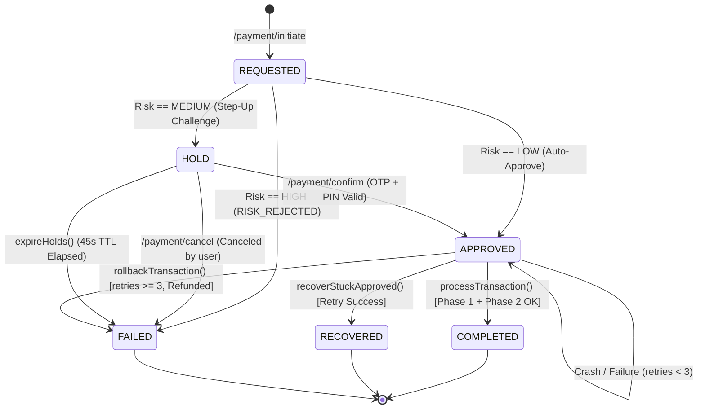
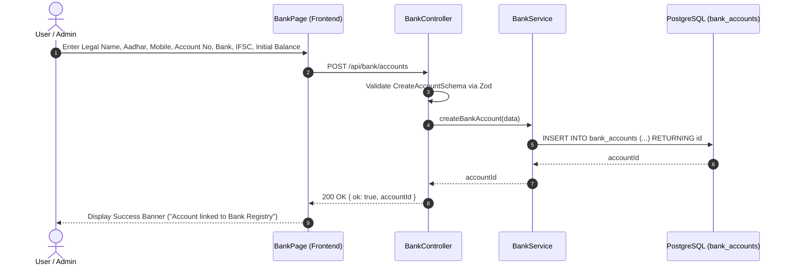
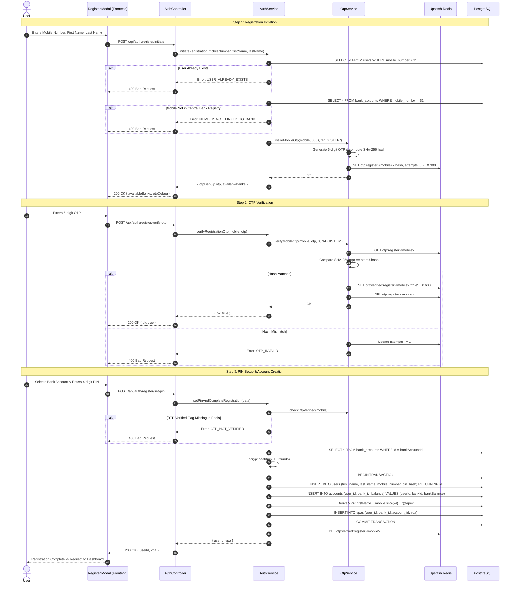
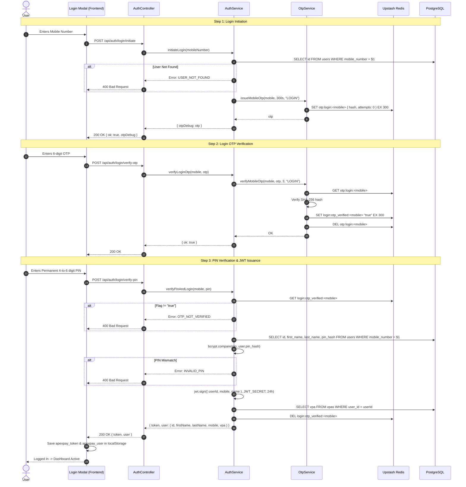
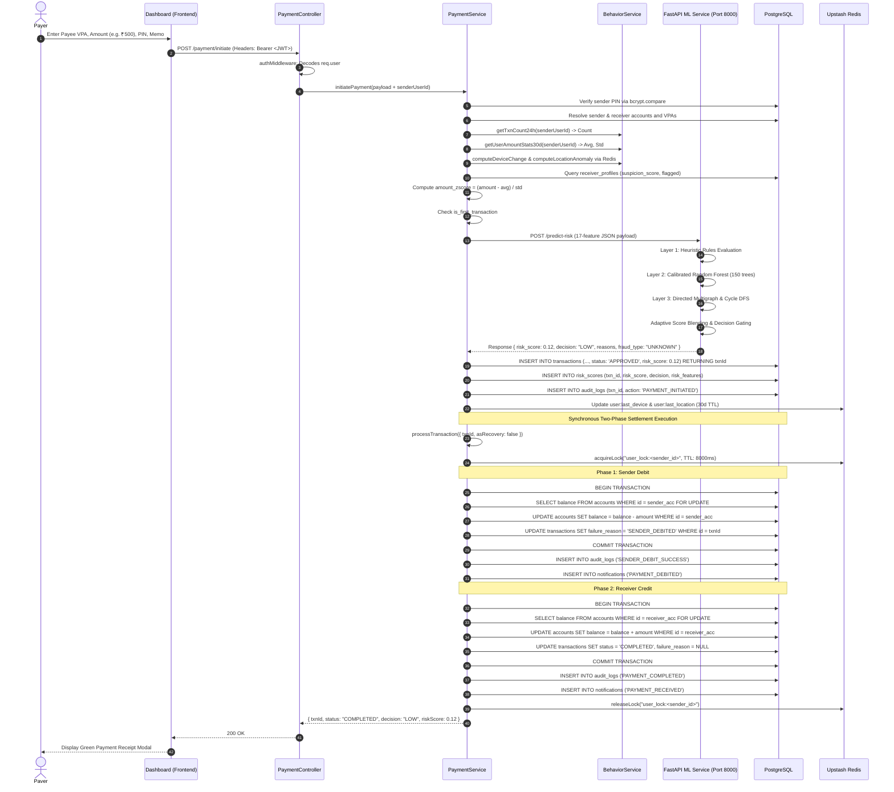
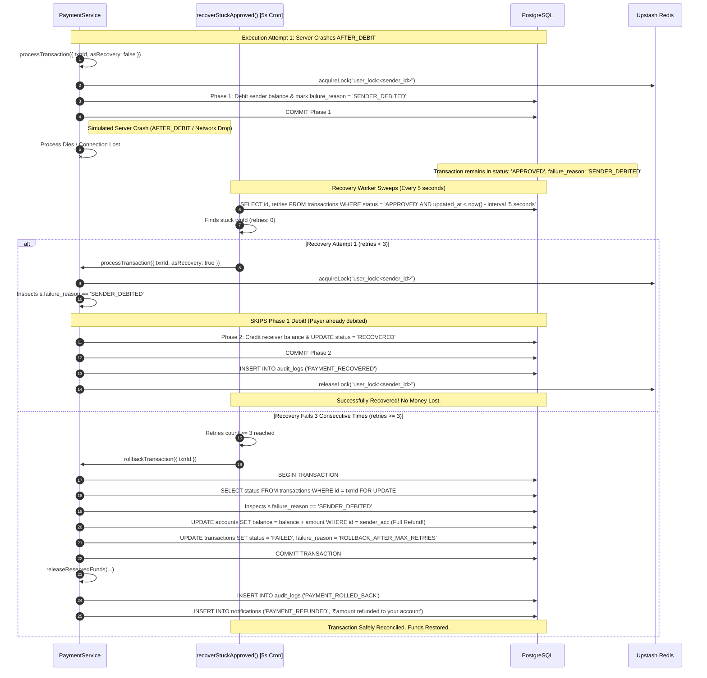
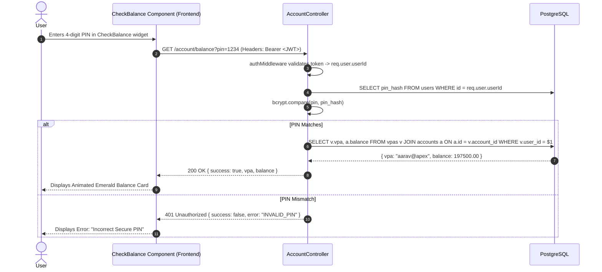

# ApexPay - Master System Workflows & Sequence Specifications

This document specifies the end-to-end operational workflows, control logic, state machines, and sequence diagrams for all core transaction and security mechanisms implemented in **ApexPay**.

---

## 1. High-Level Transaction State Machine

The lifecycle of every payment in ApexPay transitions through a strict deterministic finite state automaton governed by the `transaction_status` PostgreSQL enum:



---

## 2. End-to-End Workflow Specifications

### 2.1 Workflow 1: Central Bank Registry Simulation
**Objective:** Create a verified source-of-truth bank account in the Central Bank Registry before onboarding onto ApexPay.



---

### 2.2 Workflow 2: Multi-Step User Registration & Onboarding
**Objective:** Verify that the user's mobile number exists in the Central Bank Registry, issue an ephemeral SMS OTP, verify the OTP, hash a secure PIN, and create the user's primary linked wallet and default VPA.



---

### 2.3 Workflow 3: Two-Factor Authentication Login
**Objective:** Authenticate user via two independent factors: temporary SMS OTP (Possession) and permanent bcrypt PIN (Knowledge).



---

### 2.4 Workflow 4: Payment Initiation & Pre-Settlement Risk Scoring (LOW Risk Path)
**Objective:** Process a low-risk transaction instantaneously without user friction.



---

### 2.5 Workflow 5: Payment Initiation with Step-Up Challenge (MEDIUM Risk Path)
**Objective:** Suspend an anomalous transaction on `HOLD` for 45 seconds, reserve in-flight funds, issue an OTP challenge, and settle upon verification.

```mermaid
sequenceDiagram
    autonumber
    actor Payer as Payer
    participant UI as Dashboard (Frontend)
    participant PC as PaymentController
    participant PS as PaymentService
    participant RS as ReserveService
    participant OS as OtpService
    participant ML as FastAPI ML Service
    participant DB as PostgreSQL
    participant R as Upstash Redis

    Payer->>UI: Enters Anomalous Payment (e.g. ₹25,000 from new device)
    UI->>PC: POST /payment/initiate
    PC->>PS: initiatePayment(...)
    PS->>ML: POST /predict-risk
    ML-->>PS: Response { risk_score: 0.58, decision: "MEDIUM", reasons: ["New device", "High Z-Score"] }

    PS->>DB: INSERT INTO transactions (status: 'HOLD', otp_required: true, hold_expires_at: now() + 45s) RETURNING txnId
    PS->>RS: reserveFunds({ accountId, amount, balanceLimit })
    RS->>R: acquireLock("reserve_lock:<accId>")
    RS->>R: GET reserve:account:<accId> -> current
    RS->>RS: Assert (current + amount <= balanceLimit)
    RS->>R: SET reserve:account:<accId> (current + amount) EX 3600
    RS->>R: releaseLock("reserve_lock:<accId>")

    PS->>OS: issueOtp({ txnId, ttlSeconds: 45 })
    OS->>R: SET otp:txn:<txnId> { hash, attempts: 0 } EX 45
    PS->>DB: INSERT INTO notifications ('HOLD_TRIGGERED')
    PS-->>PC: { txnId, status: "HOLD", holdExpiresAt, otpRequired: true, otpDebug }
    PC-->>UI: 200 OK { status: "HOLD", otpDebug }

    UI->>UI: Launch 45-Second Countdown Timer & OTP Input Modal
    UserVerification:
    alt Payer Enters Valid OTP within 45 seconds
        Payer->>UI: Submits OTP + PIN
        UI->>PC: POST /payment/confirm { txnId, otp, pin }
        PC->>PS: confirmPayment(...)
        PS->>DB: SELECT status, hold_expires_at FROM transactions WHERE id = txnId
        PS->>PS: Assert status == 'HOLD' AND hold_expires_at > now()
        PS->>OS: verifyOtp({ txnId, otp, maxAttempts: 5 })
        OS->>R: GET otp:txn:<txnId> & verify SHA-256
        OS->>R: DEL otp:txn:<txnId>
        PS->>DB: UPDATE transactions SET status = 'APPROVED', confirmed_at = now()
        PS->>DB: INSERT INTO audit_logs ('HOLD_CONFIRMED')
        PS->>PS: processTransaction({ txnId, asRecovery: false })
        PS->>RS: releaseReservedFunds({ accountId, amount })
        PS-->>PC: Status: COMPLETED
        PC-->>UI: 200 OK { status: "COMPLETED" }
        UI-->>Payer: Display Success Receipt
    else 45-second Timer Expires Without Verification
        Note over PS,DB: Background Hold Expiration Sweep (Every 5s)
        PS->>DB: SELECT id FROM transactions WHERE status = 'HOLD' AND hold_expires_at < now()
        PS->>DB: UPDATE transactions SET status = 'FAILED', failure_reason = 'HOLD_EXPIRED'
        PS->>RS: releaseReservedFunds({ accountId, amount })
        PS->>DB: INSERT INTO audit_logs ('HOLD_EXPIRED_AUTO')
        PS->>DB: INSERT INTO notifications ('PAYMENT_STATUS', 'HOLD expired')
        UI->>UI: Status polling detects FAILED -> Displays "Transaction Timed Out"
    else Payer Clicks "Cancel Payment"
        Payer->>UI: Clicks Cancel
        UI->>PC: POST /payment/cancel { txnId }
        PC->>PS: cancelPayment(...)
        PS->>DB: UPDATE transactions SET status = 'FAILED', failure_reason = 'CANCELED_BY_USER'
        PS->>RS: releaseReservedFunds({ accountId, amount })
        PS->>DB: INSERT INTO audit_logs ('HOLD_CANCELED')
        PC-->>UI: 200 OK { status: "FAILED" }
    end
```

---

### 2.6 Workflow 6: Crash Resilience, Two-Phase Recovery & Auto-Rollback
**Objective:** Guarantee data consistency when a server crashes after debiting the payer but before crediting the payee.



---

### 2.7 Workflow 7: Secure Balance Inquiry
**Objective:** Enforce zero-knowledge balance security where account balances are only exposed after active cryptographic PIN verification.


