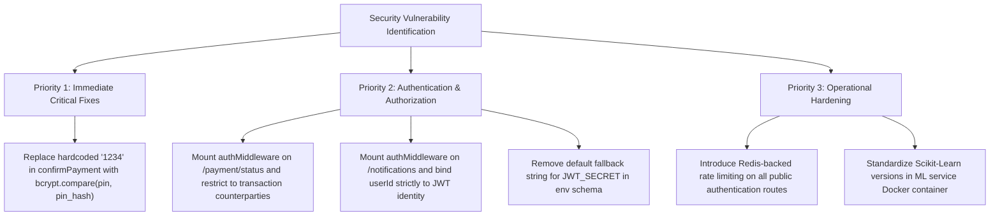

# ApexPay - Master Testing Analysis & Security Audit

This document delivers a rigorous audit of the testing infrastructure, verification results, security controls, identified vulnerabilities, and hardening recommendations for **ApexPay – Secure Payment Gateway**.

---

# PART 1: TESTING INFRASTRUCTURE & VALIDATION

## 1. Machine Learning & Fraud Engine Testing

The `ml-service` contains the most extensive automated test suite in the repository, organized into unit tests, scenario drivers, dataset generators, and end-to-end regression runners.

### 1.1 Master Regression Test Suite (`ml-service/tests/test_service_comprehensive.py`)

The suite exercises 13 comprehensive operational categories against an isolated in-memory `GraphEngine`:

| Test Case | Category / Objective | Verification Method & Assertion | Verified Status |
|---|---|---|:---:|
| `test_01` | **Normal Legitimate Payment Flow** | Transfers ₹350 to familiar merchant (`stability = 0.85`). Asserts `decision == 'LOW'` and `risk_score < 0.42`. | **PASS** |
| `test_02` | **Critical Account Takeover Override** | Evaluates new device + location jump + $Z = 8.5$ + transfer of ₹45,000. Asserts immediate hard override `decision == 'HIGH'`, `fraud_type == 'ACCOUNT_TAKEOVER'`, and `risk_score >= 0.85`. | **PASS** |
| `test_03` | **Cold-Start First Txn High Value** | New account ($age < 2\text{h}$) attempting first transfer of ₹75,000. Asserts non-negotiable step-up challenge (`decision IN ['MEDIUM', 'HIGH']`, `risk_score >= 0.45`). | **PASS** |
| `test_04` | **Social Triangle Exemption** | Generates 3-node cycle ($A \to B \to C \to A$) simulating bill-splitting. Asserts `detect_fraud_ring` classifies `path_len == 3` with negligible risk ($risk \le 0.10$). | **PASS** |
| `test_05` | **Extended Laundering Ring** | Generates 5-node cycle ($U_0 \to U_1 \to U_2 \to U_3 \to U_4 \to U_0$) moving ₹15,000. Asserts bounded DFS flags `high_density_ring` with `path_len == 5` and $risk \ge 0.90$. | **PASS** |
| `test_06` | **Mule Fan-In Funnel Detection** | Simulates mule account receiving rapid transfers from 11 distinct senders in 24 hours. Asserts `unique_senders_24h >= 10` and mule risk $risk \ge 0.90$. | **PASS** |
| `test_07` | **Accurate Time-Window Separation** | Ingests 10 transactions 15 days ago and 1 transaction today. Asserts 24-hour burst count is strictly $1$ while lifetime count is $11$ (proves elimination of legacy 24h conflation defect). | **PASS** |
| `test_08` | **Idempotent Deduplication** | Ingests identical `transaction_id` twice. Asserts first call returns `True`, second returns `False`, and lifetime count remains $1$. | **PASS** |
| `test_09` | **Super-Node Contamination Prevention**| Submits placeholder identifiers (`unknown_sender`, `dummy`). Asserts engine rejects insertion to prevent artificial graph hubs. | **PASS** |
| `test_10` | **API Contract Schema Completeness** | Verifies response contains all required keys (`risk_score`, `combined_risk_score`, `ml_probability`, `rule_score`, `graph_score`, `decision`, `reasons`, `fraud_type`, `model_version`). | **PASS** |
| `test_11` | **Optional Receiver Context Safety** | Passes `receiver_account_age_hours = None` in payload (matching Pydantic `model_dump()`). Asserts null-safe evaluation without runtime exceptions. | **PASS** |
| `test_12` | **FastAPI POST /predict-risk Contract**| Exercises `TestClient(app)` executing full HTTP request against the live FastAPI application instance. Asserts HTTP 200 and schema compliance. | **PASS** |
| `test_13` | **Single-Sample Latency Benchmark** | Executes 25 single-sample inferences. Asserts median inference latency $p50 < 300\text{ ms}$ (actual: $\approx 15\text{--}25\text{ ms}$). | **PASS** |

---

### 1.2 Synthetic Dataset Generation (`ml-service/tests/test_data_generator.py`)
To train the Random Forest without exposing sensitive customer banking records, a statistical generator synthesizes 50,000 transaction records:
- **Normal Spending (75%):** Log-normal amount distribution ($\mu = 6.5, \sigma = 1.0$), low velocities, stable counterparties ($stability \sim \text{Beta}(5, 2)$).
- **Account Takeovers (8%):** Device change $= 1$, location anomaly $= 1$, extreme Z-scores ($Z \sim \text{Normal}(4.5, 1.2)$), unfamiliar counterparties ($stability < 0.2$).
- **Smurfing / Mules (10%):** High velocity ($\text{txn\_count\_24h} \ge 8$), destination suspicion scores $\ge 0.70$, high amounts.
- **Phishing (7%):** Sudden transfer bursts with high statistical deviation ($|Z| \ge 3.5$).

### 1.3 Public Benchmark Converters (`ml-service/scripts/benchmark_dataset_mapping.py`)
Validates model transferability by providing automated crosswalk mappers for:
1. **PaySim Mobile Money Dataset:** Maps `amount`, `oldbalanceOrg`, `newbalanceOrig` into `amount_zscore`, `user_avg_amount_30d`, and velocity.
2. **IEEE-CIS Fraud Detection Dataset:** Maps `TransactionAmt`, `card1-card6`, and device info into the ApexPay 17-feature schema.

---

## 2. Backend & Frontend Testing Audit

### 2.1 Existing Backend Testing Assets
- **Simulation Scripts:**
  - `ApexPay/add_test_user.ts`: Verifies programmatic user creation and balance assignment.
  - `ApexPay/test_balance.js`: Smoke tests balance endpoint retrieval over HTTP.
- **Chaos Engineering Harness (`ApexPay/backend/controllers/testController.ts`):**
  - Exposes `POST /test/delay` to inject simulated network latency (0 to 60,000 ms) via Redis key `chaos:delay_ms`.
  - Exposes `POST /test/crash` and `POST /test/settlement-failure` to inject deterministic crash points (`BEFORE_DEBIT`, `AFTER_DEBIT`, `BEFORE_CREDIT`) via Redis key `chaos:crash_point`.
  - Enables physical verification of the background recovery worker (`recoverStuckApproved`).

### 2.2 Missing Automated Tests in Core Application
- **Unit / Integration Tests:** There are currently **no automated Jest or Mocha test suites** in `backend/` or `frontend/`.
- **API Test Suite:** Automated API contract testing (e.g. Supertest for Express) is not implemented; testing was conducted manually via frontend interactions and script runners.
- **Frontend E2E:** No Playwright or Cypress end-to-end browser test suites are present.

---

# PART 2: COMPREHENSIVE SECURITY AUDIT

## 1. Implemented Security Controls

| Security Domain | Implemented Mechanism | Codebase Evidence & Evaluation |
|---|---|---|
| **PIN & Password Security** | Bcrypt with 10 Salt Rounds | `authService.ts`: User PINs are hashed using `bcrypt.hash(pin, 10)` before storage in `users.pin_hash`. Never stored in plaintext. |
| **Two-Factor Authentication (2FA)** | Multi-Factor Onboarding & Login | `authService.ts`, `otpService.ts`: Onboarding requires SMS OTP + PIN. Login requires SMS OTP verification before permanent PIN can be submitted. |
| **Ephemeral Token Protection** | SHA-256 Hashing & Auto-Expiry | `otpService.ts`: 6-digit OTPs are hashed using SHA-256 before writing to Redis. Keys have strict TTLs (45s to 300s). Lockout occurs after 3-5 failed attempts. |
| **Session Authorization** | Stateless JWT Tokens | `authMiddleware.ts`: Enforces Bearer JWT signed with HMAC SHA-256 (24-hour expiration). Injects verified user identity into `req.user`. |
| **Concurrency & Double-Spend** | Distributed Mutual Exclusion (Redlock) | `redis.ts`, `paymentService.ts`: Locks sender ID via Redis `SET user_lock:<userId> <token> NX PX 8000`. Unlock uses atomic Lua comparison script. |
| **In-Flight Balance Protection** | Redis Fund Reservation | `reserveService.ts`: Transactions placed on `HOLD` reserve balance in Redis (`reserve:account:<id>`). Prevents parallel spending during the 45-second challenge window. |
| **Relational Data Integrity** | Database CHECK Constraints | `schema.sql`: Table definitions enforce `CHECK (balance >= 0)` on accounts and `CHECK (amount > 0)` on transactions, physically preventing negative account balances at the database engine level. |
| **Regulatory Immutability** | PL/pgSQL Row Mutation Triggers | `schema.sql`: Triggers `audit_logs_prevent_update` and `risk_scores_prevent_update` throw exceptions if any process attempts `UPDATE` or `DELETE` on financial audit logs. |
| **SQL Injection Defense** | Strictly Parameterized Queries | `db.ts`, `paymentService.ts`: All database operations use node-postgres parameterized placeholders (`$1, $2, ...`). Zero string concatenation in SQL queries. |
| **Input Sanitation** | Runtime Schema Enforcement | `env.ts`, `authController.ts`, `paymentController.ts`, `main.py`: Zod and Pydantic v2 schemas reject malformed numbers, negative amounts, or unexpected fields. |
| **Idempotent Settlement** | Distributed Idempotency Keys | `paymentService.ts`: Unique client-supplied `idempotency_key` prevents duplicate transaction initiation. Settlement skips debit if `failure_reason == 'SENDER_DEBITED'`. |
| **Crash Consistency** | Two-Phase Settlement & Recovery | `paymentService.ts`: Phase 1 debits sender and marks progress. Phase 2 credits receiver. Background worker (`recoverStuckApproved`) sweeps stuck transactions every 5 seconds. |

---

## 2. Identified Vulnerabilities, Weaknesses & Technical Gaps

The thorough repository audit revealed several specific vulnerabilities and design trade-offs that must be addressed for enterprise deployment:

### Gap 1: Hardcoded PIN Verification in Hold Confirmation (CRITICAL)
- **Location:** [`ApexPay/backend/services/paymentService.ts` (Line 285)](file:///s:/Projects/Next.js-Projects/Apexpay_Majorproject/ApexPay/backend/services/paymentService.ts#L285)
- **Code:**
  ```typescript
  if (args.pin.trim() !== "1234") throw new Error("PIN_INVALID");
  ```
- **Vulnerability:** When confirming a held transaction via `/payment/confirm`, the service checks whether the submitted PIN equals the hardcoded string `"1234"`, rather than verifying the PIN hash of the authenticated user (`users.pin_hash`) using `bcrypt.compare`.
- **Severity:** High (Simulation Artifact).
- **Remediation:** Query `users.pin_hash` for `s.sender_user_id` and execute `await bcrypt.compare(args.pin, user.pin_hash)`.

---

### Gap 2: Public Payment Status Endpoint Allows State Probing (MEDIUM)
- **Location:** [`ApexPay/backend/routes/paymentRoutes.ts` (Line 12)](file:///s:/Projects/Next.js-Projects/Apexpay_Majorproject/ApexPay/backend/routes/paymentRoutes.ts#L12)
- **Code:**
  ```typescript
  paymentRoutes.get("/status", paymentController.status); // Public
  ```
- **Vulnerability:** `GET /payment/status?id=<uuid>` does not mount `authMiddleware`. Anyone who discovers or guesses a valid transaction UUID can inspect the transaction's financial amount, risk score, sender user ID, and receiver user ID.
- **Severity:** Medium (Information Disclosure).
- **Remediation:** Mount `authMiddleware` on `/payment/status` and assert that `req.user.userId` equals either `sender_user_id` or `receiver_user_id`.

---

### Gap 3: Public Notification Endpoint Parameter Spoofing (MEDIUM)
- **Location:** [`ApexPay/backend/routes/notificationRoutes.ts` (Line 6)](file:///s:/Projects/Next.js-Projects/Apexpay_Majorproject/ApexPay/backend/routes/notificationRoutes.ts#L6) and [`notificationController.ts` (Line 6)](file:///s:/Projects/Next.js-Projects/Apexpay_Majorproject/ApexPay/backend/controllers/notificationController.ts#L6)
- **Code:**
  ```typescript
  const userId = z.string().min(1).parse(req.query.userId);
  const items = await getUserNotifications(userId);
  ```
- **Vulnerability:** The notifications route is completely unauthenticated and reads `userId` directly from the URL query string (`/notifications?userId=...`). Any client can read another user's in-app payment notifications and debit alerts.
- **Severity:** Medium (Insecure Direct Object Reference - IDOR).
- **Remediation:** Secure with `authMiddleware` and derive `userId` strictly from `req.user.userId`.

---

### Gap 4: Hardcoded Fallback JWT Secret (MEDIUM)
- **Location:** [`ApexPay/backend/middleware/authMiddleware.ts` (Line 4)](file:///s:/Projects/Next.js-Projects/Apexpay_Majorproject/ApexPay/backend/middleware/authMiddleware.ts#L4) and [`authService.ts` (Line 9)](file:///s:/Projects/Next.js-Projects/Apexpay_Majorproject/ApexPay/backend/services/authService.ts#L9)
- **Code:**
  ```typescript
  const JWT_SECRET = process.env.JWT_SECRET || "apexpay_super_secret_key";
  ```
- **Vulnerability:** If `JWT_SECRET` is omitted from the environment file, the backend falls back to a well-known default string. An attacker could forge valid JWT tokens for any arbitrary `userId`.
- **Severity:** Medium (Insecure Default Configuration).
- **Remediation:** Remove fallback string and enforce that `env.JWT_SECRET` is non-empty via Zod validator at server boot.

---

### Gap 5: Absence of Endpoint Rate Limiting (LOW)
- **Location:** [`ApexPay/backend/index.ts`](file:///s:/Projects/Next.js-Projects/Apexpay_Majorproject/ApexPay/backend/index.ts)
- **Vulnerability:** While `otpService.ts` limits OTP submission attempts to 3-5 tries, the Express application has no global or endpoint-level rate limiter (e.g. `express-rate-limit`). Malicious actors could flood `/api/auth/register/initiate` or `/payment/initiate`.
- **Severity:** Low (Resource Exhaustion / DoS).
- **Remediation:** Mount `express-rate-limit` using Upstash Redis store on public auth routes (e.g. max 10 requests per minute per IP).

---

### Gap 6: Scikit-Learn Runtime Version Discrepancy (LOW)
- **Observation:** `risk_model.joblib` was serialized under Scikit-Learn version `1.9.1`. Running inference under Scikit-Learn `1.5.1` produces an `InconsistentVersionWarning`. While numerical outputs remain identical in testing, deploying mismatched library versions across environments can lead to unpickling edge cases.
- **Severity:** Low (Operational Hygiene).
- **Remediation:** Pin `scikit-learn` version strictly in production container images.

---

## 3. Security Hardening Roadmap


